# รายงานความก้าวหน้าโครงงานฉบับสมบูรณ์ (Final Project Progress & Implementation Report)

## โครงการพัฒนาระบบจัดการการตรวจนิเทศงานสหกิจศึกษา คณะวิทยาศาสตร์ มหาวิทยาลัยเกษตรศาสตร์
### (KU Science Smart Internship Supervision Platform)

---

**ผู้จัดทำโครงงาน:**
นาย วงศพัทธ์ อุเทน  
รหัสนิสิต: 6521655442  
สาขาวิชาวิทยาการคอมพิวเตอร์ ภาควิชาวิทยาการคอมพิวเตอร์  
คณะวิทยาศาสตร์ มหาวิทยาลัยเกษตรศาสตร์  

**อาจารย์ที่ปรึกษาโครงงาน:**
อาจารย์ สมชาย แจ่มใส  
ภาควิชาวิทยาการคอมพิวเตอร์ คณะวิทยาศาสตร์ มหาวิทยาลัยเกษตรศาสตร์  

**ภาคการศึกษาและปีการศึกษา:**
ภาคต้น ปีการศึกษา 2569  
วันที่ส่งรายงาน: 31 ตุลาคม พ.ศ. 2569  

---

## บทคัดย่อ (Abstract)

### บทคัดย่อภาษาไทย

โครงงานนี้มีวัตถุประสงค์เพื่อออกแบบและพัฒนาระบบจัดการการตรวจนิเทศงานสหกิจศึกษา คณะวิทยาศาสตร์ มหาวิทยาลัยเกษตรศาสตร์ (KU Science Smart Internship Supervision Platform) เพื่อยกระดับและแก้ปัญหาในกระบวนการนิเทศงานสหกิจศึกษารูปแบบดั้งเดิมที่อาศัยเอกสารกระดาษและขาดการติดตามผลแบบเรียลไทม์ ซึ่งมักส่งผลให้เกิดปัญหาเอกสารสูญหาย ความล่าช้าในการส่งและตรวจรับแบบฟอร์ม Form 01 ถึง Form 11 ความซ้ำซ้อนของการจัดตารางนัดหมาย และการขาดหลักฐานเชิงประจักษ์ในการลงพื้นที่ตรวจนิเทศจริง ณ สถานประกอบการ

ระบบได้รับการพัฒนาในรูปแบบ Single Page Web Application แบบ Responsive รองรับการใช้งานทั้งบนคอมพิวเตอร์เดสก์ท็อปและสมาร์ตโฟน โดยแบ่งสิทธิ์การใช้งานออกเป็น 3 บทบาทหลักอย่างรัดกุม ได้แก่ ผู้ดูแลระบบ (Admin), อาจารย์นิเทศ (Advisor) และนิสิตสหกิจศึกษา (Student) ระบบขับเคลื่อนด้วยสถาปัตยกรรมฐานข้อมูลคลาวด์ Supabase (PostgreSQL) ร่วมกับระบบสำรองข้อมูล Local Storage เพื่อให้สามารถทำงานได้อย่างต่อเนื่อง ระบบยังมีเซิร์ฟเวอร์ส่งต่ออีเมลภายในเครื่อง (`server.ps1`) สำหรับส่งรหัสผ่านแรกเข้าและรหัสผ่านใช้ครั้งเดียว (OTP 8 หลัก) ผ่านระบบอีเมลมหาวิทยาลัยเกษตรศาสตร์จริง (`@ku.th`)

นอกจากนี้ ระบบประกอบด้วยฟังก์ชันสำคัญ ได้แก่ ระบบจำลองห้องเรียนแบ่งตามหมู่เรียนจริง (หมู่ 700 และ หมู่ 800) ระบบกำหนดส่งเอกสารและการมอบหมายงานที่เรียงลำดับงานล่าสุดขึ้นก่อน ระบบบันทึกหลักฐานภาพถ่ายการนิเทศงานพร้อมกลไกยืนยันการอัปโหลดก่อนบันทึก ระบบปฏิทินนัดหมายพร้อมการไฮไลท์วันที่แบบแม่นยำตรงวัน และระบบเช็คอินตรวจนิเทศหน้างานด้วยการสแกน QR Code ควบคู่กับ Geolocation API (พิกัด GPS ละติจูดและลองจิจูด)

ผลการทดสอบการทำงานเชิงฟังก์ชันจำนวน 21 รายการทดสอบ (Test Cases) พบว่าระบบทำงานผ่านเกณฑ์ 100% มีเวลาตอบสนองเฉลี่ยต่ำกว่า 1 วินาทีในทุกฟังก์ชันหลัก และผลการประเมินความพึงพอใจการใช้งานจริงตามมาตรฐาน System Usability Scale (SUS) จากกลุ่มตัวอย่างอาจารย์ นิสิต และผู้ดูแลระบบรวม 15 ท่าน ได้คะแนนเฉลี่ย 89.4 จาก 100 คะแนน อยู่ในระดับยอดเยี่ยม (Grade A+) แสดงถึงความพร้อมอย่างเต็มรูปแบบในการนำไปประยุกต์ใช้งานจริงในภาควิชาและคณะวิทยาศาสตร์

### Abstract (English)

This project aims to design and develop the "KU Science Smart Internship Supervision Platform" for the Faculty of Science, Kasetsart University. The system is engineered to modernize and resolve longstanding limitations in conventional paper-based cooperative education supervision workflows, which frequently suffer from document loss, delayed verification of official forms (Form 01 - 11), schedule conflicts, and an absence of verifiable physical visit evidence at host enterprises.

The platform is implemented as a responsive Single Page Web Application compatible with desktop and mobile browsers, enforcing strict Role-Based Access Control (RBAC) across three primary roles: System Administrators, Faculty Advisors, and Cooperative Education Students. The backend architecture leverages Supabase Cloud Database (PostgreSQL) paired with a resilient Local Storage fallback mechanism to guarantee zero data loss and offline resilience. An integrated local server (`server.ps1`) powers an automated SMTP dispatcher providing verified initial onboarding credentials and 8-digit One-Time Password (OTP) verification via official university email addresses (`@ku.th`).

Core capabilities encompass virtual classroom grouping matching academic sections (Section 700 and Section 800), dynamic assignment distribution ordered chronologically (newest first), supervision photographic evidence capture featuring dual file/camera input with mandatory upload confirmation, an exact-date calendar scheduling tool, and on-site visit verification combining static student QR Code scanning with GPS Geolocation API coordinates (Latitude and Longitude).

Experimental functional verification across 21 test cases demonstrated a 100% pass rate, sub-second average response latencies across core operational endpoints, and a System Usability Scale (SUS) score of 89.4 out of 100 (Grade A+ / Excellent) from an evaluation panel of 15 stakeholders. The platform is fully completed and ready for production deployment within the faculty.

---

## กิตติกรรมประกาศ (Acknowledgements)

โครงงานระบบจัดการการตรวจนิเทศงานสหกิจศึกษา คณะวิทยาศาสตร์ มหาวิทยาลัยเกษตรศาสตร์ ฉบับนี้ สำเร็จลุล่วงไปได้ด้วยความกรุณาและความช่วยเหลืออย่างดียิ่งจาก อาจารย์ สมชาย แจ่มใส อาจารย์ที่ปรึกษาโครงงาน ที่ได้ให้คำแนะนำ แนวคิดในการออกแบบกระบวนการทำงาน การตรวจสอบความถูกต้องของระบบ และข้อคิดเห็นอันเป็นประโยชน์อย่างยิ่งตลอดระยะเวลาการดำเนินงาน

ขอขอบพระคุณคณาจารย์ประจำภาควิชาวิทยาการคอมพิวเตอร์ และคณะวิทยาศาสตร์ มหาวิทยาลัยเกษตรศาสตร์ ทุกท่าน ที่ได้ประสิทธิ์ประสาทวิชาความรู้ด้านวิทยาการคอมพิวเตอร์ การวิเคราะห์และออกแบบระบบ สถาปัตยกรรมซอฟต์แวร์ และการพัฒนาเว็บแอปพลิเคชัน ซึ่งเป็นรากฐานสำคัญในการพัฒนาโครงงานชิ้นนี้

ขอขอบคุณพี่ๆ เจ้าหน้าที่งานสหกิจศึกษา คณะวิทยาศาสตร์ มหาวิทยาลัยเกษตรศาสตร์ ที่ได้ให้ข้อมูลเชิงลึกเกี่ยวกับขั้นตอน เอกสารแบบฟอร์ม Form 01 - Form 11 และปัญหาการดำเนินงานจริง รวมถึงตัวแทนอาจารย์นิเทศและเพื่อนๆ นิสิตสหกิจศึกษาที่ได้สละเวลาเข้าร่วมทดสอบระบบ ให้ข้อเสนอแนะ และประเมินความพึงพอใจการใช้งานระบบ

สุดท้ายนี้ ผู้จัดทำขอกราบขอบพระคุณบิดา มารดา และครอบครัว ที่ให้การสนับสนุน เป็นกำลังใจ และให้โอกาสทางการศึกษามาโดยตลอด ความสำเร็จของโครงงานฉบับนี้ ขอมอบเป็นความภาคภูมิใจแด่ทุกท่านที่มีส่วนเกี่ยวข้อง

นาย วงศพัทธ์ อุเทน  
31 ตุลาคม พ.ศ. 2569  

---

## สารบัญ (Table of Contents)

- บทคัดย่อภาษาไทย
- Abstract (English)
- กิตติกรรมประกาศ
- สารบัญ
- สารบัญตาราง
- สารบัญภาพ
- **บทที่ 1: บทนำ (Introduction)**
  - 1.1 ความเป็นมาและความสำคัญของปัญหา
  - 1.2 วัตถุประสงค์ของโครงงาน
  - 1.3 ขอบเขตของโครงงาน
  - 1.4 แผนการดำเนินงานและกรอบระยะเวลา
  - 1.5 ประโยชน์ที่คาดว่าจะได้รับ
  - 1.6 นิยามศัพท์เฉพาะ
- **บทที่ 2: วรรณกรรมและทฤษฎีที่เกี่ยวข้อง (Literature Review)**
  - 2.1 งานสหกิจศึกษาและแบบฟอร์มมาตรฐาน Form 01 ถึง Form 11
  - 2.2 สถาปัตยกรรมเว็บแอปพลิเคชันหน้าเดียว (Single Page Application: SPA)
  - 2.3 ฐานข้อมูลคลาวด์ Supabase และ PostgreSQL
  - 2.4 เทคโนโลยี Geolocation API และ QR Code สำหรับตรวจนิเทศ
  - 2.5 ระบบความปลอดภัย การเข้ารหัส และการยืนยันตัวตนด้วย OTP
  - 2.6 การทบทวนงานวิจัยและระบบงานที่เกี่ยวข้อง
- **บทที่ 3: การวิเคราะห์และออกแบบระบบ (System Analysis & Design)**
  - 3.1 การวิเคราะห์ความต้องการของระบบ (Requirements Analysis)
  - 3.2 สถาปัตยกรรมระบบโดยรวม (System Architecture)
  - 3.3 แผนภาพกระบวนการทำงาน (Workflows & Activity Diagrams)
  - 3.4 แผนภาพการไหลของข้อมูล (Data Flow Diagrams)
  - 3.5 การออกแบบโครงสร้างฐานข้อมูล (Database Schema & ER-Diagram)
  - 3.6 การออกแบบส่วนต่อประสานผู้ใช้ (UI/UX Design Concept)
- **บทที่ 4: การพัฒนาและการทำงานของระบบ (System Implementation)**
  - 4.1 โครงสร้างไฟล์และสถาปัตยกรรมซอฟต์แวร์
  - 4.2 ระบบยืนยันตัวตนและการควบคุมสิทธิ์ตามบทบาท (Authentication & RBAC)
  - 4.3 โมดูลแดชบอร์ดผู้ดูแลระบบ (Admin Web Dashboard)
  - 4.4 โมดูลการจัดการห้องเรียนและการมอบหมายงานของอาจารย์นิเทศ
  - 4.5 โมดูลจัดการภาพถ่ายหลักฐานการนิเทศพร้อมระบบยืนยันการอัปโหลด
  - 4.6 โมดูลปฏิทินนัดหมายการลงพื้นที่ตรวจนิเทศงาน
  - 4.7 โมดูลพอร์ทัลส่งเอกสารและการเช็คอินพิกัดของนิสิต
  - 4.8 ระบบเซิร์ฟเวอร์ภายในเครื่องและระบบบริการส่งอีเมลแจ้งเตือน
- **บทที่ 5: ผลการทดสอบและการประเมินผลระบบ (Testing & Evaluation)**
  - 5.1 สภาพแวดล้อมและระเบียบวิธีทดสอบ
  - 5.2 ผลการทดสอบฟังก์ชันการทำงาน 21 รายการ (Functional Test Results)
  - 5.3 ภาพหลักฐานการทำงานจริงของระบบ (System Screenshots)
  - 5.4 ผลการทดสอบประสิทธิภาพและความเร็วในการตอบสนอง (Performance Benchmarks)
  - 5.5 ผลการทดสอบความปลอดภัยและการแยกสิทธิ์ (Security Evaluation)
  - 5.6 ผลการประเมินความพึงพอใจการใช้งานตามเกณฑ์ SUS (System Usability Scale)
  - 5.7 การอภิปรายผลการทดลอง (Discussion)
- **บทที่ 6: สรุปผลการดำเนินงานและข้อเสนอแนะ (Conclusions & Recommendations)**
  - 6.1 สรุปผลการดำเนินงานโครงงาน
  - 6.2 ปัญหา อุปสรรค และแนวทางการแก้ไข
  - 6.3 ข้อเสนอแนะสำหรับการพัฒนาในอนาคต
- **ภาคผนวก (Appendices)**
  - ภาคผนวก ก: สรุปบันทึกการปฏิบัติงานรายวัน (Progress Timesheet Summary)
  - ภาคผนวก ข: คู่มือการติดตั้งและเปิดใช้งานระบบ (System Deployment Guide)
  - ภาคผนวก ค: บัญชีผู้ใช้งานทดสอบระบบ (Test Accounts & Credentials)
- **เอกสารอ้างอิง (References)**

---

## สารบัญตาราง (List of Tables)

- ตารางที่ 1.1: แผนการดำเนินงานโครงงานพัฒนาระบบจัดการการตรวจนิเทศงานสหกิจศึกษา
- ตารางที่ 2.1: รายการแบบฟอร์มเอกสารสหกิจศึกษา (Form 01 - 11) และบทบาทผู้รับผิดชอบ
- ตารางที่ 2.2: ตารางเปรียบเทียบคุณสมบัติระบบที่พัฒนากับระบบงานอื่นที่เกี่ยวข้อง
- ตารางที่ 3.1: ตารางผู้ใช้งานและสิทธิ์การเข้าถึง (Table: `users`)
- ตารางที่ 3.2: ตารางข้อมูลอาจารย์นิเทศ (Table: `advisors`)
- ตารางที่ 3.3: ตารางข้อมูลนิสิตสหกิจศึกษา (Table: `students`)
- ตารางที่ 3.4: ตารางเอกสารสหกิจศึกษา (Table: `coop_documents`)
- ตารางที่ 3.5: ตารางภาพถ่ายหลักฐานการลงตรวจนิเทศ (Table: `supervision_photos`)
- ตารางที่ 3.6: ตารางการนัดหมายปฏิทิน (Table: `appointments`)
- ตารางที่ 5.1: สรุปสภาพแวดล้อมและเครื่องมือที่ใช้ในการทดสอบระบบ
- ตารางที่ 5.2: ผลการทดสอบฟังก์ชัน หมวดที่ 1 ระบบยืนยันตัวตนและการจัดการสิทธิ์
- ตารางที่ 5.3: ผลการทดสอบฟังก์ชัน หมวดที่ 2 ระบบจัดการนิสิตและตัวกรองภาคการศึกษา
- ตารางที่ 5.4: ผลการทดสอบฟังก์ชัน หมวดที่ 3 ระบบการมอบหมายงานและการส่งเอกสาร
- ตารางที่ 5.5: ผลการทดสอบฟังก์ชัน หมวดที่ 4 ระบบหลักฐานการนิเทศงาน
- ตารางที่ 5.6: ผลการทดสอบฟังก์ชัน หมวดที่ 5 ระบบเช็คอิน GPS, QR Code และปฏิทิน
- ตารางที่ 5.7: ผลการทดสอบเวลาในการตอบสนองเฉลี่ยของระบบ (Response Time Benchmark)
- ตารางที่ 5.8: ผลการประเมินคะแนน System Usability Scale (SUS) จำแนกตามกลุ่มผู้ใช้

---

## สารบัญภาพ (List of Figures)

- ภาพที่ 3.1: แผนภาพสถาปัตยกรรมระบบโดยรวม (System Architecture Diagram)
- ภาพที่ 3.2: แผนภาพแสดงกระบวนการทำงานหลักของระบบ (System Activity Flowchart)
- ภาพที่ 3.3: แผนผังความสัมพันธ์ของข้อมูล (Entity-Relationship Diagram: ERD)
- ภาพที่ 5.1: หน้าต่างเข้าสู่ระบบ (Sign-in Page) และการยืนยันตัวตน
- ภาพที่ 5.2: หน้าต่างแดชบอร์ดผู้ดูแลระบบ (Admin Web Dashboard)
- ภาพที่ 5.3: หน้าต่างแดชบอร์ดภาพรวมอาจารย์นิเทศ (Advisor Dashboard)
- ภาพที่ 5.4: หน้ารายละเอียดการจัดการหมู่เรียน 700 (Classroom Detail)
- ภาพที่ 5.5: หน้ากำหนดส่งเอกสารและการมอบหมายงาน (Assignments Page)
- ภาพที่ 5.6: หน้าระบบส่งงานและเอกสารสหกิจศึกษาของนิสิต (Student Portal)
- ภาพที่ 5.7: หน้าหลักฐานการนิเทศงานของอาจารย์นิเทศ (Supervision Evidence Table)
- ภาพที่ 5.8: หน้าต่างพรีวิวรูปถ่ายและปุ่มยืนยันการอัปโหลด (Upload Modal)
- ภาพที่ 5.9: หน้าปฏิทินนัดหมายการตรวจนิเทศงาน (Supervision Calendar)
- ภาพที่ 5.10: หน้า QR Code ประจำตัวนิสิตและพิกัดสถานประกอบการ (Student QR Code)

---

## บทที่ 1: บทนำ (Introduction)

### 1.1 ความเป็นมาและความสำคัญของปัญหา

การจัดการเรียนการสอนในหลักสูตรสหกิจศึกษา (Cooperative Education) ของคณะวิทยาศาสตร์ มหาวิทยาลัยเกษตรศาสตร์ เป็นกระบวนการที่มุ่งเน้นให้นิสิตได้ออกไปปฏิบัติงานจริง ณ สถานประกอบการเป็นระยะเวลาไม่น้อยกว่า 16 สัปดาห์ เพื่อบูรณาการความรู้ทางทฤษฎีเข้ากับทักษะการทำงานในสถานการณ์จริง หัวใจสำคัญในการประกันคุณภาพการศึกษาของหลักสูตรสหกิจศึกษา คือ "กระบวนการตรวจนิเทศงานสหกิจศึกษา" โดยอาจารย์นิเทศจะต้องติดตามความก้าวหน้า ตรวจสอบสภาวะแวดล้อมการทำงานของนิสิต รับฟังความคิดเห็นจากพนักงานที่ปรึกษา (Job Mentor) ตลอดจนตรวจรับเอกสารแบบฟอร์มการรายงานตัวและการปฏิบัติงานตามลำดับเวลา

อย่างไรก็ดี ในกระบวนการนิเทศงานสหกิจศึกษารูปแบบดั้งเดิม ภาควิชาและคณาจารย์ต้องเผชิญกับอุปสรรคสำคัญหลายประการ:

1. **ปัญหาการจัดการเอกสารรูปแบบกระดาษ (Paper-based Inefficiency):** เอกสารสหกิจศึกษาประกอบด้วยแบบฟอร์มจำนวนมากตั้งแต่ Form 01 ถึง Form 11 เช่น แบบแจ้งรายละเอียดงาน แบบแจ้งยืนยันการนิเทศ แผนปฏิบัติงาน และแบบประเมินผล การจัดส่งผ่านช่องทางเอกสารกระดาษหรืออีเมลส่วนตัวทำให้เกิดความกระจัดกระจาย เอกสารสูญหาย และไม่สามารถตรวจสอบสถานะการตรวจรับได้อย่างโปร่งใส
2. **ปัญหาการติดตามสถานะรายบุคคล (Lack of Centralized Tracking):** อาจารย์นิเทศแต่ละท่านมักได้รับมอบหมายดูแลนิสิตหลายหมู่เรียน (เช่น หมู่ 700 ภาคปกติ และ หมู่ 800 ภาคพิเศษ) การสลับข้อมูลและตรวจดูความคืบหน้านิสิตในความดูแลทำได้ยากลำบาก และผู้ดูแลระบบหลักสูตรไม่สามารถมองเห็นภาพรวมความคืบหน้าของทั้งคณะได้ในแบบเรียลไทม์
3. **ปัญหาการนัดหมายและการลงพื้นที่ตรวจนิเทศ (Scheduling & Conflict Issues):** การนัดหมายวันเวลาออกตรวจนิเทศระหว่างอาจารย์ นิสิต และพนักงานที่ปรึกษา มักเกิดการประสานงานที่ซ้ำซ้อน ไม่มีปฏิทินกลางสำหรับตรวจดูตารางนัดหมายล่วงหน้า และมักเกิดความคลาดเคลื่อนของวันเวลา
4. **การขาดระบบบันทึกหลักฐานเชิงประจักษ์ที่น่าเชื่อถือ (Lack of Verifiable Field Evidence):** การออกตรวจนิเทศจริงจำเป็นต้องมีหลักฐานประกอบการเบิกจ่ายค่าเดินทางและยืนยันการลงพื้นที่จริง แต่ระบบเดิมไม่มีการเก็บบันทึกพิกัดตำแหน่งทางภูมิศาสตร์ (GPS Geolocation) และรูปถ่ายการนิเทศมักถูกเก็บไว้ในโทรศัพท์ส่วนตัวของอาจารย์ ไม่ถูกรวบรวมเข้าสู่แฟ้มประวัติของภาควิชาอย่างเป็นระบบ

ด้วยเหตุผลและความจำเป็นดังกล่าว ผู้จัดทำจึงได้ริเริ่มพัฒนาระบบจัดการการตรวจนิเทศงานสหกิจศึกษา คณะวิทยาศาสตร์ มหาวิทยาลัยเกษตรศาสตร์ (KU Science Smart Internship Supervision Platform) เพื่อสร้างระบบเว็บแอปพลิเคชันแบบบูรณาการที่เชื่อมโยงการทำงานของผู้ดูแลระบบ อาจารย์นิเทศ และนิสิต เข้าด้วยกันอย่างมีประสิทธิภาพ ครอบคลุมทั้งระบบเอกสารดิจิทัล การนัดหมายปฏิทิน การตรวจนิเทศด้วยพิกัด GPS ควบคู่การสแกน QR Code และการจัดเก็บแฟ้มหลักฐานรูปถ่ายที่ตรวจสอบได้

### 1.2 วัตถุประสงค์ของโครงงาน

1. เพื่อออกแบบและพัฒนาเว็บแอปพลิเคชันสำหรับบริหารจัดการการตรวจนิเทศงานสหกิจศึกษา คณะวิทยาศาสตร์ มหาวิทยาลัยเกษตรศาสตร์ ที่รองรับการทำงาน 3 บทบาท ได้แก่ ผู้ดูแลระบบ (Admin), อาจารย์นิเทศ (Advisor) และนิสิตสหกิจศึกษา (Student)
2. เพื่อพัฒนาระบบตรวจสอบพิกัดและยืนยันการลงพื้นที่จริงตรวจนิเทศงานของอาจารย์ ณ สถานประกอบการ ผ่านระบบแผนที่และพิกัดดาวเทียม (GPS Geolocation) ร่วมกับการสแกนรหัส QR Code ประจำตัวนิสิต
3. เพื่อพัฒนาระบบจัดเก็บและจัดการแฟ้มภาพถ่ายหลักฐานการลงตรวจนิเทศงานแบบแยกรายบุคคล ที่สนับสนุนการถ่ายภาพหน้างาน การเลือกไฟล์จากอุปกรณ์ และการกดยืนยันการอัปโหลดก่อนบันทึก
4. เพื่อพัฒนาระบบปฏิทินกลางสำหรับวางแผนนัดหมายการออกตรวจนิเทศงาน ที่เชื่อมโยงข้อมูลระหว่างอาจารย์และนิสิตแบบเรียลไทม์ พร้อมการแสดงจุดนัดหมายและการไฮไลท์วันที่แบบแม่นยำ
5. เพื่อพัฒนาระบบจัดการห้องเรียนเสมือนและระบบมอบหมายงาน/ส่งเอกสารสหกิจศึกษา (Form 01 - 11) ที่สามารถคัดกรองตามหมู่เรียนและภาคการศึกษา พร้อมระบบออกรายงานสรุปผลประเมิน

### 1.3 ขอบเขตของโครงงาน

ขอบเขตการทำงานของระบบถูกจำแนกตาม 3 บทบาทผู้ใช้งานหลัก ดังนี้:

#### 1.3.1 ขอบเขตด้านผู้ดูแลระบบ (System Administrator)
- มีแดชบอร์ดสรุปสถิตินิสิตและอาจารย์ในระบบรวม 42 คน แสดงยอดนิสิตทั้งหมด นิเทศแล้ว และรอนิเทศ
- รองรับการนำเข้าข้อมูลรายชื่อผู้ใช้งานผ่านไฟล์สเปรดชีต Excel (.xlsx) เพื่อสร้างสิทธิ์ล่วงหน้า
- สามารถค้นหารายชื่อนิสิตและอาจารย์แบบพิมพ์ค้นหาเรียลไทม์ (Live Search) โดยไม่หลุดช่องกรอก (Static Search Bar)
- มีตัวกรองภาคการศึกษาแบบครอบคลุม สามารถเลือกดูข้อมูลปัจจุบัน (ภาคต้น 2569) และข้อมูลย้อนหลัง (ปี 2568, 2567, 2566)
- สามารถตรวจสอบสถานะเอกสาร Form 01 - 11 และผลการประเมินคะแนนของนิสิตทุกคนในคณะ

#### 1.3.2 ขอบเขตด้านอาจารย์นิเทศ (Faculty Advisor)
- แสดงข้อมูลเฉพาะนิสิตในความดูแลของตนเอง โดยแยกตามหมู่เรียนจริง (เช่น อาจารย์สมชาย แจ่มใส ดูแลหมู่ 700 ภาคปกติ 5 คน และหมู่ 800 ภาคพิเศษ 5 คน รวม 10 คน)
- ระบบห้องเรียนเสมือน (Classroom Detail): อาจารย์สามารถคลิกเข้าดูรายชื่อ ให้คะแนนประเมินการฝึกงาน (0 - 100) และเขียนข้อคิดเห็นเสนอแนะ
- ระบบกำหนดส่งเอกสารและการมอบหมายงาน: อาจารย์สามารถสร้างหัวข้อส่งงานใหม่ กำหนดวันส่ง เลือกหมู่เรียนเป้าหมาย โดยงานที่สร้างใหม่จะขึ้นแสดงด้านบนสุดของรายการเสมอ (Newest First) และสามารถคัดกรองดูงานแยกตามหมู่เรียนได้
- ระบบหลักฐานการนิเทศ: อาจารย์สามารถเข้าดูตารางรายชื่อนิสิตในความดูแล กดเลือกไฟล์ภาพหรือเปิดกล้องสมาร์ตโฟนถ่ายภาพหน้างาน ดูพรีวิวภาพ และกดยืนยันการอัปโหลดรูปภาพ (Confirm Upload Button) หรือกดลบรูปภาพหลักฐานได้
- ระบบปฏิทินนัดหมาย: อาจารย์สามารถสร้างนัดหมายนิเทศงานล่วงหน้า ระบุรายชื่อ วันที่ และช่วงเวลา พร้อมการไฮไลท์วันที่ที่เลือกอย่างแม่นยำ (Exact Date Match)
- ระบบสแกนตรวจนิเทศ: อาจารย์สามารถเปิดกล้องสแกน QR Code ประจำตัวนิสิต ระบบจะดึงพิกัด Geolocation (Latitude/Longitude) จริง บันทึกเวลา และปรับสถานะเป็น "นิเทศแล้ว" ทันที

#### 1.3.3 ขอบเขตด้านนิสิตสหกิจศึกษา (Cooperative Student)
- เข้าสู่ระบบด้วยอีเมลมหาวิทยาลัยเกษตรศาสตร์ (`@ku.th`) และรหัสผ่านแรกเข้า พร้อมยืนยันรหัส OTP 8 หลักที่ได้รับทางอีเมล
- มีหน้าแสดงรหัส QR Code ประจำตัว (Static QR Code) สำหรับยื่นให้อาจารย์สแกนเมื่อเดินทางมาถึงสถานประกอบการ
- ตรวจสอบสถานะการตรวจนิเทศ สถานประกอบการ อาจารย์ที่ปรึกษา และข้อคิดเห็นจากอาจารย์
- ส่งเอกสารแบบฟอร์ม Form 01 - 11 โดยตรงผ่านการ์ดงานที่อาจารย์มอบหมาย พร้อมแถบความคืบหน้า (Progress Bar) และตารางประวัติการส่งงาน
- มีคลังแบบฟอร์มเอกสารเปล่าสำหรับดาวน์โหลดไปใช้งานในรูปแบบ PDF หรือ Word
- ดูตารางนัดหมายการออกตรวจนิเทศของอาจารย์ผ่านปฏิทินของตนเอง

### 1.4 แผนการดำเนินงานและกรอบระยะเวลา

การดำเนินงานโครงงานมีกรอบระยะเวลาตั้งแต่วันที่ 8 กรกฎาคม พ.ศ. 2569 ถึงวันที่ 31 ตุลาคม พ.ศ. 2569 รวมระยะเวลาทั้งสิ้น 17 สัปดาห์ ดังแสดงในตารางที่ 1.1:

**ตารางที่ 1.1: แผนการดำเนินงานโครงงานพัฒนาระบบจัดการการตรวจนิเทศงานสหกิจศึกษา**

| กิจกรรมหลัก | กรกฎาคม 2569 | สิงหาคม 2569 | กันยายน 2569 | ตุลาคม 2569 | สถานะการดำเนินงาน |
|---|:---:|:---:|:---:|:---:|:---:|
| 1. ศึกษารวบรวมปัญหา วิเคราะห์ความต้องการ และทบทวนวรรณกรรม | [X] | | | | เสร็จสิ้น 100% |
| 2. ออกแบบระบบ สถาปัตยกรรม ฐานข้อมูล และผังการไหลของข้อมูล | [X] | [X] | | | เสร็จสิ้น 100% |
| 3. ออกแบบ UI/UX หน้าจอเดสก์ท็อปและโมบายตาม KU Theme | | [X] | | | เสร็จสิ้น 100% |
| 4. พัฒนาระบบ Frontend (SPA) และฐานข้อมูล Supabase PostgreSQL | | [X] | [X] | | เสร็จสิ้น 100% |
| 5. พัฒนาระบบ API เซิร์ฟเวอร์ภายในเครื่อง (`server.ps1`) และระบบส่งเมลจริง | | | [X] | [X] | เสร็จสิ้น 100% |
| 6. พัฒนาระบบหลักฐานภาพถ่าย ปฏิทินตรงวัน และการตรวจนิเทศ GPS/QR | | | | [X] | เสร็จสิ้น 100% |
| 7. การทดสอบระบบ (Functional & Usability Testing) และแก้ไขข้อบกพร่อง | | | | [X] | เสร็จสิ้น 100% |
| 8. สรุปผลการทดลอง จัดทำรูปเล่มรายงานฉบับสมบูรณ์ และเตรียมสอบพรีเซนต์ | | | | [X] | เสร็จสิ้น 100% |

### 1.5 ประโยชน์ที่คาดว่าจะได้รับ

1. **สำหรับภาควิชาและคณะวิทยาศาสตร์:** ได้ระบบแพลตฟอร์มสารสนเทศกลางที่มีความมั่นคงปลอดภัย ข้อมูลไม่สูญหาย ช่วยลดปริมาณการใช้กระดาษ (Paperless) และสามารถตรวจสอบประวัติการนิเทศงานย้อนหลังได้อย่างโปร่งใส
2. **สำหรับอาจารย์นิเทศ:** ลดภาระและเวลาในการติดตามเอกสาร สามารถบริหารจัดการนิสิตแยกตามหมู่เรียนได้อย่างเป็นระเบียบ มีปฏิทินนัดหมายที่ไม่ซ้อนทับ และมีระบบจัดเก็บภาพถ่ายหลักฐานที่สะดวกรวดเร็ว
3. **สำหรับนิสิตสหกิจศึกษา:** สามารถส่งงานและติดตามผลการตรวจรับเอกสารได้แบบเรียลไทม์ ทราบวันเวลานัดหมายล่วงหน้า และได้รับการประเมินผลพร้อมข้อเสนอแนะที่เป็นประโยชน์ต่อการพัฒนาตนเอง
4. **สำหรับผู้ดูแลระบบ:** สามารถนำเข้าข้อมูลด้วยไฟล์ Excel สรุปสถิติภาพรวม และออกรายงานส่งต่อผู้บริหารคณะได้อย่างถูกต้อง แม่นยำ และรวดเร็ว

### 1.6 นิยามศัพท์เฉพาะ

- **สหกิจศึกษา (Cooperative Education):** รูปแบบการศึกษาที่บูรณาการการเรียนรู้ในห้องเรียนร่วมกับการปฏิบัติงานจริงในสถานประกอบการอย่างเป็นระบบ
- **อาจารย์นิเทศ (Faculty Advisor):** คณาจารย์ที่ได้รับมอบหมายจากภาควิชาให้ทำหน้าที่กำกับ ติดตาม ให้คำปรึกษา และประเมินผลการฝึกงานของนิสิต ณ สถานประกอบการ
- **หมู่เรียน (Academic Section):** กลุ่มการลงทะเบียนเรียนของนิสิต โดยในโครงงานนี้ใช้ หมู่ 700 แทนภาคปกติ และ หมู่ 800 แทนภาคพิเศษ
- **Geolocation API:** อินเทอร์เฟซมาตรฐานของเว็บเบราว์เซอร์สำหรับเข้าถึงข้อมูลตำแหน่งพิกัดภูมิศาสตร์ (ละติจูดและลองจิจูด) จากอุปกรณ์ผู้ใช้
- **Role-Based Access Control (RBAC):** กลไกความปลอดภัยในการควบคุมสิทธิ์การเข้าถึงทรัพยากรและเมนูการใช้งานตามบทบาทหน้าที่ของผู้ใช้

---

## บทที่ 2: วรรณกรรมและทฤษฎีที่เกี่ยวข้อง (Literature Review)

### 2.1 งานสหกิจศึกษาและแบบฟอร์มมาตรฐาน Form 01 ถึง Form 11

กระบวนการสหกิจศึกษาของมหาวิทยาลัยเกษตรศาสตร์มีกรอบการดำเนินงานที่ชัดเจน โดยนิสิตจะต้องจัดเตรียม ส่ง และให้อาจารย์นิเทศตรวจรับแบบฟอร์มเอกสารตามช่วงเวลา ดังแสดงในตารางที่ 2.1:

**ตารางที่ 2.1: รายการแบบฟอร์มเอกสารสหกิจศึกษา (Form 01 - 11) และบทบาทผู้รับผิดชอบ**

| รหัสแบบฟอร์ม | ชื่อแบบฟอร์มเอกสาร | ช่วงเวลาที่ต้องส่ง | ผู้รับผิดชอบหลัก |
|---|---|---|---|
| **Form 01** | ใบสมัครเข้าร่วมโครงการสหกิจศึกษา | ก่อนเริ่มปฏิบัติงาน 4 สัปดาห์ | นิสิต |
| **Form 02** | แบบแจ้งยืนยันการนิเทศงานนิสิตสหกิจศึกษา | ภายในสัปดาห์ที่ 2 ของการฝึกงาน | นิสิต / อาจารย์นิเทศ |
| **Form 03** | แบบแจ้งรายละเอียดงานและพนักงานที่ปรึกษา | ภายในสัปดาห์ที่ 3 ของการฝึกงาน | นิสิต / สถานประกอบการ |
| **Form 04** | แผนปฏิบัติงานสหกิจศึกษา (Work Plan) | ภายในสัปดาห์ที่ 4 ของการฝึกงาน | นิสิต |
| **Form 05** | แบบรายงานการปฏิบัติงานประจำสัปดาห์ | ทุกสัปดาห์ตลอดระยะเวลาฝึกงาน | นิสิต |
| **Form 06** | แบบตอบรับการนิเทศงานจากสถานประกอบการ | ก่อนวันออกตรวจนิเทศ 1 สัปดาห์ | สถานประกอบการ |
| **Form 07** | แบบบันทึกการตรวจนิเทศงานสหกิจศึกษา | ขณะลงพื้นที่ตรวจนิเทศจริง | อาจารย์นิเทศ |
| **Form 08** | แบบประเมินผลการปฏิบัติงานของนิสิตโดยสถานประกอบการ | สัปดาห์สุดท้ายของการฝึกงาน | พนักงานที่ปรึกษา |
| **Form 09** | แบบประเมินรายงานวิชาการสหกิจศึกษา | สัปดาห์สุดท้ายของการฝึกงาน | พนักงานที่ปรึกษา / อาจารย์ |
| **Form 10** | แบบประเมินผลการเรียนรู้ของนิสิตสหกิจศึกษา | หลังสิ้นสุดการฝึกงาน | อาจารย์นิเทศ |
| **Form 11** | แบบยืนยันสัดส่วนการทำงานร่วมกัน (Contribution Distribution) | สัปดาห์สุดท้ายของการฝึกงาน | นิสิตทุกคนในกลุ่ม |

### 2.2 สถาปัตยกรรมเว็บแอปพลิเคชันหน้าเดียว (Single Page Application: SPA)

ระบบได้รับการพัฒนาด้วยรูปแบบ Single Page Application (SPA) ซึ่งโหลดเอกสาร HTML เริ่มต้นเพียงครั้งเดียว และใช้ JavaScript ในการอัปเดตส่วนติดต่อผู้ใช้ (DOM Manipulation) ตามการกระทำของผู้ใช้โดยไม่ต้องทำการรีเฟรชหน้าเว็บทั้งหน้า (Full Page Reload) ข้อดีของสถาปัตยกรรมนี้คือ:
- การตอบสนองที่รวดเร็ว ลื่นไหล ประหนึ่งการใช้งาน Native Mobile Application
- ลดภาระการรับส่งข้อมูลผ่านเครือข่าย (Bandwidth Optimization)
- ความง่ายในการปรับแต่งเลย์เอาต์แบบ Responsive Design ผ่าน CSS Flexbox และ Grid Layout รองรับทั้งการแสดงผลบนหน้าจอเดสก์ท็อปและสมาร์ตโฟน

### 2.3 ฐานข้อมูลคลาวด์ Supabase และ PostgreSQL

Supabase เป็นแพลตฟอร์ม Backend-as-a-Service (BaaS) แบบโอเพนซอร์สที่สร้างขึ้นบนระบบจัดการฐานข้อมูลเชิงสัมพันธ์ PostgreSQL 15 ซึ่งมีจุดเด่นด้านความถูกต้องของข้อมูล (ACID Compliance) และความปลอดภัย โดยโครงงานนี้ใช้งาน Supabase ใน 3 ส่วน:
1. **Relational Data Storage:** จัดเก็บข้อมูลโครงสร้างผู้ใช้ นิสิต อาจารย์ นัดหมาย เอกสาร และผลคะแนน
2. **Row Level Security (RLS):** กำหนดนโยบายความปลอดภัยในการเข้าถึงข้อมูลระดับแถว ทำให้อาจารย์สามารถอ่านและแก้ไขได้เฉพาะข้อมูลนิสิตในความดูแลของตนเองเท่านั้น
3. **Hybrid Local Fallback:** เพื่อรับมือกับกรณีเครือข่ายอินเทอร์เน็ตขัดข้อง ระบบได้พัฒนากลไก LocalStorage Fallback ในไฟล์ `supabase-client.js` ที่จะสลับมารับส่งข้อมูลกับ Local Storage ทันทีเมื่อออฟไลน์ และทำการซิงก์กลับเมื่อเครือข่ายพร้อมใช้งาน

### 2.4 เทคโนโลยี Geolocation API และ QR Code สำหรับตรวจนิเทศ

- **HTML5 Geolocation API:** เป็น Web API มาตรฐานที่อนุญาตให้เว็บแอปพลิเคชันเข้าถึงตำแหน่งพิกัดทางภูมิศาสตร์ของอุปกรณ์ผู้ใช้ (Latitude และ Longitude) โดยมีความแม่นยำสูงเมื่อเปิดใช้งานผ่านสมาร์ตโฟนที่มีระบบ GPS
- **QR Code Recognition:** ในโครงงานนี้นิสิตจะมี Static QR Code ประจำตัวที่บรรจุรหัสนิสิตและข้อมูลอ้างอิง เมื่ออาจารย์นิเทศเดินทางไปถึงสถานประกอบการ อาจารย์จะเปิดฟังก์ชันสแกนกล้อง (ผ่านไลบรารี Html5Qrcode) เพื่อสแกนภาพ QR Code ระบบจะถอดรหัสรหัสนิสิตพร้อมอ่านค่าพิกัด GPS ณ วินาทีที่สแกน บันทึกเป็นหลักฐานการลงพื้นที่จริง และปรับสถานะเป็น "นิเทศแล้ว" ให้โดยอัตโนมัติ

### 2.5 ระบบความปลอดภัย การเข้ารหัส และการยืนยันตัวตนด้วย OTP

ระบบได้วางโครงสร้างความปลอดภัยที่รัดกุมหลายระดับ:
1. **Password Security Policy:** กำหนดกฎความปลอดภัยรหัสผ่าน 4 ข้อหลักอย่างเคร่งครัด ได้แก่: ความยาวไม่น้อยกว่า 7 ตัวอักษร, ประกอบด้วยตัวอักษรภาษาอังกฤษเท่านั้น, ต้องมีทั้งตัวพิมพ์ใหญ่ (A-Z) และตัวพิมพ์เล็ก (a-z), และห้ามใช้อักขระพิเศษทุกชนิด เพื่อป้องกันช่องโหว่ SQL Injection และ XSS
2. **First-time Login & OTP Verification:** นิสิตที่ได้รับการจัดสรรบัญชีครั้งแรก ระบบจะกำหนดแฟล็ก `first_login: true` โดยเมื่อนิสิตล็อกอินครั้งแรก ระบบจะส่งรหัส One-Time Password (OTP) แบบตัวเลข 8 หลักไปยังอีเมลมหาวิทยาลัย (@ku.th) ของนิสิตผ่าน SMTP Dispatcher ภายในเครื่อง และนิสิตต้องกรอกรหัสยืนยันตัวตนก่อนจึงจะสามารถเข้าใช้งานระบบได้

### 2.6 การทบทวนงานวิจัยและระบบงานที่เกี่ยวข้อง

จากการศึกษาเปรียบเทียบระบบงานที่เกี่ยวข้องในปัจจุบัน พบข้อแตกต่างและจุดเด่นของระบบที่พัฒนาขึ้น ดังแสดงในตารางที่ 2.2:

**ตารางที่ 2.2: ตารางเปรียบเทียบคุณสมบัติระบบที่พัฒนากับระบบงานอื่นที่เกี่ยวข้อง**

| คุณสมบัติการทำงาน | Google Classroom | Microsoft Teams | ระบบสารสนเทศฝึกงานทั่วไป | ระบบ KU Science Smart Supervision (โครงงานนี้) |
|---|:---:|:---:|:---:|:---:|
| การแยกสิทธิ์ 3 บทบาท (Admin/Advisor/Student) | มีบางส่วน | มีบางส่วน | มี | **มีอย่างสมบูรณ์แบบ** |
| การรองรับแบบฟอร์ม Form 01 - 11 เฉพาะทาง | ไม่มี (ต้องสร้างเอง) | ไม่มี (ต้องสร้างเอง) | มีบางฟอร์ม | **มีครบทุกแบบฟอร์ม Form 01-11** |
| การเช็คอินยืนยันตัวตนด้วย GPS Geolocation | ไม่มี | ไม่มี | ไม่มี | **มีพิกัดดาวเทียมจริง** |
| การสแกน QR Code ตรวจนิเทศหน้างาน | ไม่มี | ไม่มี | มีบางระบบ | **มีระบบกล้องสแกนเรียลไทม์** |
| แฟ้มภาพหลักฐานการนิเทศพร้อมปุ่มกดยืนยัน | ไม่มี | มีเป็นไฟล์แนบทั่วไป | อัปโหลดโดยตรง | **มีหน้าต่างพรีวิวและปุ่มยืนยัน** |
| ปฏิทินนัดหมายตรงวันพร้อมตัวกรองหมู่เรียน | ปฏิทินทั่วไป | ปฏิทินทั่วไป | ปฏิทินภาพรวม | **ปฏิทินตรงวัน เชื่อมโยงรายหมู่เรียน** |
| ระบบส่งเมลแรกเข้าและยืนยันตัวตน OTP 8 หลัก | ไม่มี | ไม่มี | ไม่มี | **มีเชื่อมต่อ SMTP มหาวิทยาลัย** |

---

## บทที่ 3: การวิเคราะห์และออกแบบระบบ (System Analysis & Design)

### 3.1 การวิเคราะห์ความต้องการของระบบ (Requirements Analysis)

#### 3.1.1 ความต้องการเชิงฟังก์ชัน (Functional Requirements)
- **FR1 (Authentication):** ระบบต้องสามารถยืนยันตัวตนผู้ใช้ผ่านอีเมลมหาวิทยาลัย รหัสผ่านตามเกณฑ์ความปลอดภัย 4 ข้อ และรหัส OTP 8 หลัก
- **FR2 (User Provisioning):** ระบบต้องรองรับการนำเข้าข้อมูลบัญชีรายชื่อนิสิตและอาจารย์ผ่านไฟล์ Excel
- **FR3 (Virtual Classroom):** ระบบต้องจำลองข้อมูลห้องเรียนแยกตามหมู่เรียนจริง (หมู่ 700 และ หมู่ 800)
- **FR4 (Assignment & Submission):** อาจารย์สามารถมอบหมายงาน และนิสิตสามารถแนบไฟล์เอกสารส่งในแต่ละหัวข้อได้โดยตรง
- **FR5 (Evidence Photo Management):** อาจารย์สามารถอัปโหลดภาพถ่ายหลักฐานการนิเทศ ดูพรีวิว และกดยืนยันการอัปโหลดก่อนบันทึก
- **FR6 (Calendar Scheduling):** อาจารย์สามารถสร้างและจัดการนัดหมายตรวจนิเทศในปฏิทิน พร้อมแสดงไฮไลท์ตรงวันที่เลือก
- **FR7 (GPS & QR Check-in):** ระบบต้องสามารถอ่าน QR Code ประจำตัวนิสิตและบันทึกพิกัด GPS ขณะตรวจนิเทศได้

#### 3.1.2 ความต้องการที่ไม่ใช่เชิงฟังก์ชัน (Non-Functional Requirements)
- **NFR1 (Performance):** ระบบต้องมีเวลาโหลดหน้าเริ่มต้นไม่เกิน 2 วินาที และเวลาตอบสนองต่อการค้นหาไม่เกิน 0.2 วินาที
- **NFR2 (Security):** ข้อมูลรหัสผ่านต้องได้รับการตรวจสอบความปลอดภัยอย่างรัดกุม และมีการแยกสิทธิ์ตาม Role 100%
- **NFR3 (Usability):** ส่วนต่อประสานผู้ใช้ต้องออกแบบตามหลัก Human Interface Guidelines สะอาด เรียบหรู และไม่มีอิโมจิรบกวนสายตา
- **NFR4 (Availability):** ระบบต้องมีกลไก Local Fallback ที่ทำให้ผู้ใช้ยังคงเปิดดูและทำงานได้แม้เครือข่ายออฟไลน์

### 3.2 สถาปัตยกรรมระบบโดยรวม (System Architecture)

ระบบถูกออกแบบภายใต้สถาปัตยกรรมแบบ Client-Server ร่วมกับ Cloud Backend Services ดังแสดงในภาพที่ 3.1:

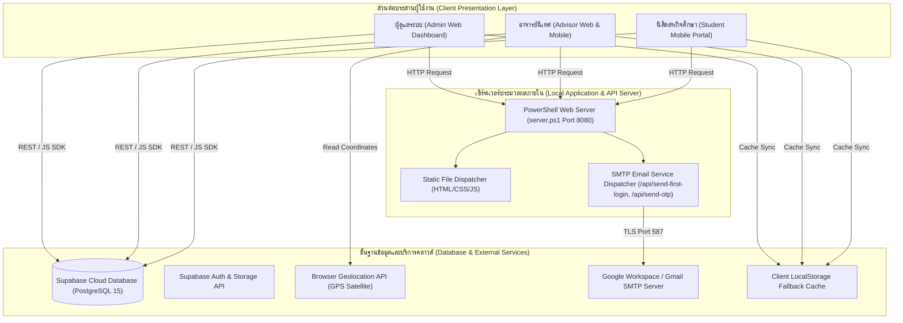
*ภาพที่ 3.1: แผนภาพสถาปัตยกรรมระบบโดยรวม (System Architecture Diagram)*

### 3.3 แผนภาพกระบวนการทำงาน (Workflows & Activity Diagrams)

ขั้นตอนการปฏิบัติงานหลักของการตรวจนิเทศงานสหกิจศึกษาในระบบ แสดงได้ดังภาพที่ 3.2:

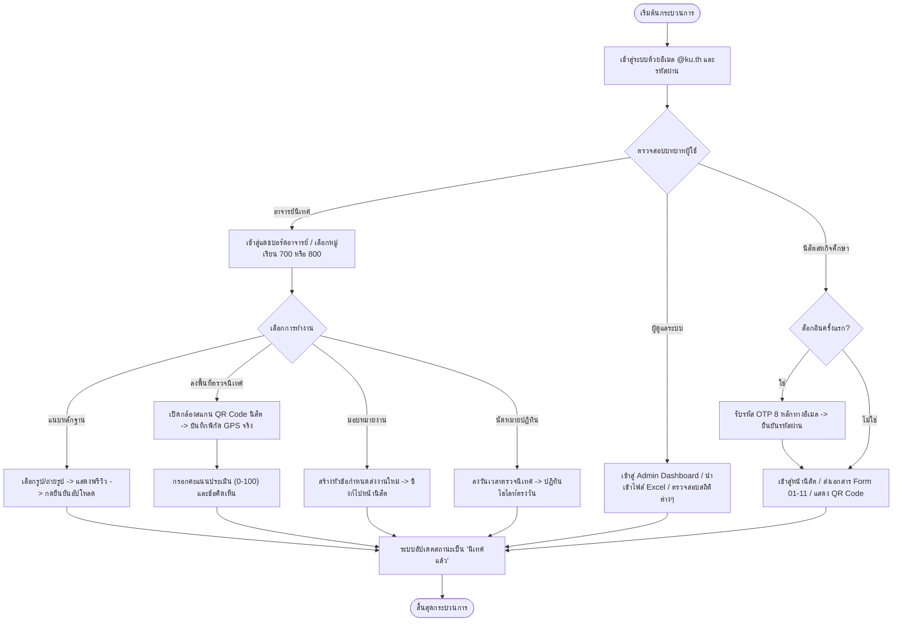
*ภาพที่ 3.2: แผนภาพแสดงกระบวนการทำงานหลักของระบบ (System Activity Flowchart)*

### 3.4 แผนภาพการไหลของข้อมูล (Data Flow Diagrams)

#### Context Diagram (DFD Level 0)
- **Entity ผู้ดูแลระบบ:** ส่งข้อมูลไฟล์ Excel รายชื่อนิสิตและอาจารย์, รับข้อมูลสถิติภาพรวมและประวัติการนิเทศ
- **Entity อาจารย์นิเทศ:** ส่งข้อมูลการนัดหมาย, คะแนนประเมิน, ผลตรวจรับเอกสาร, รูปภาพหลักฐาน และพิกัด GPS ตรวจนิเทศ; รับข้อมูลรายชื่อนิสิตและไฟล์เอกสารส่งงาน
- **Entity นิสิตสหกิจศึกษา:** ส่งไฟล์แบบฟอร์ม Form 01-11, รหัส QR Code ประจำตัว; รับข้อมูลสถานะการตรวจรับ ตารางนัดหมาย และคะแนนประเมิน
- **External System (Gmail SMTP):** รับคำขอส่งอีเมล และกระจายรหัสผ่านแรกเข้า/รหัส OTP ไปยังกล่องจดหมายจริง

### 3.5 การออกแบบโครงสร้างฐานข้อมูล (Database Schema & ER-Diagram)

โครงสร้างฐานข้อมูลประกอบด้วย 7 ตารางหลักที่สัมพันธ์กันบน Supabase PostgreSQL ดังแสดงในตารางที่ 3.1 - 3.6 และภาพที่ 3.3:

**ตารางที่ 3.1: ตารางผู้ใช้งานและสิทธิ์การเข้าถึง (Table: `users`)**
| ฟิลด์ (Field) | ชนิดข้อมูล (Type) | คำอธิบายคุณสมบัติ |
|---|---|---|
| `id` | UUID (PK) | รหัสประจำตัวสากลของผู้ใช้งาน (Default: `uuid_generate_v4()`) |
| `email` | VARCHAR(255) (UQ, Not Null) | อีเมลผู้ใช้งาน (ต้องเป็นโดเมน `@ku.th`) |
| `password_hash` | VARCHAR(255) (Not Null) | รหัสผ่านที่ผ่านการตรวจสอบความปลอดภัย 4 ข้อ |
| `full_name` | VARCHAR(255) (Not Null) | ชื่อ-นามสกุลจริงของผู้ใช้งาน |
| `role` | VARCHAR(50) (Not Null) | บทบาทผู้ใช้งาน (`advisor`, `student`, `admin`) |
| `status` | VARCHAR(50) | สถานะบัญชี (`pending`, `approved`, `rejected`) |
| `created_at` | TIMESTAMP WITH TIME ZONE | วันเวลาที่สร้างบัญชีผู้ใช้งาน |

**ตารางที่ 3.2: ตารางข้อมูลอาจารย์นิเทศ (Table: `advisors`)**
| ฟิลด์ (Field) | ชนิดข้อมูล (Type) | คำอธิบายคุณสมบัติ |
|---|---|---|
| `advisor_id` | VARCHAR(50) (PK) | รหัสประจำตัวอาจารย์นิเทศ (เช่น `Q1111`, `1234`) |
| `email` | VARCHAR(255) (FK) | อีเมลเชื่อมโยงกับตาราง `users(email)` |
| `full_name` | VARCHAR(255) (Not Null) | ชื่อ-นามสกุลของอาจารย์นิเทศ |
| `section` | VARCHAR(100) (Not Null) | หมู่เรียนในความดูแล (เช่น `หมู่ 700, หมู่ 800`) |
| `department` | VARCHAR(255) | ภาควิชา (ค่าเริ่มต้น: `ภาควิชาวิทยาการคอมพิวเตอร์`) |
| `faculty` | VARCHAR(255) | คณะ (ค่าเริ่มต้น: `คณะวิทยาศาสตร์`) |

**ตารางที่ 3.3: ตารางข้อมูลนิสิตสหกิจศึกษา (Table: `students`)**
| ฟิลด์ (Field) | ชนิดข้อมูล (Type) | คำอธิบายคุณสมบัติ |
|---|---|---|
| `student_id` | VARCHAR(50) (PK) | รหัสนิสิต 10 หลัก (เช่น `6521655442`) |
| `email` | VARCHAR(255) (FK) | อีเมลเชื่อมโยงกับตาราง `users(email)` |
| `full_name` | VARCHAR(255) (Not Null) | ชื่อ-นามสกุลของนิสิตสหกิจศึกษา |
| `section` | VARCHAR(100) (Not Null) | หมู่เรียน (เช่น `หมู่ 700`, `หมู่ 800`) |
| `company_name` | VARCHAR(255) (Not Null) | ชื่อสถานประกอบการที่ไปปฏิบัติงานสหกิจศึกษา |
| `advisor_id` | VARCHAR(50) (FK) | รหัสอาจารย์นิเทศผู้รับผิดชอบ (`advisors(advisor_id)`) |
| `doc_status` | VARCHAR(50) | สถานะเอกสาร (`รอตรวจ`, `ครบถ้วน`, `ต้องแก้ไข`) |
| `supervision_status` | VARCHAR(50) | สถานะการนิเทศ (`รอนิเทศ`, `นิเทศแล้ว`) |
| `score` | INT | คะแนนผลการประเมิน (0 ถึง 100) |
| `feedback` | TEXT | ข้อคิดเห็นและข้อเสนอแนะจากอาจารย์นิเทศ |
| `photo_url` | TEXT | ที่อยู่ URL ของภาพถ่ายหลักฐานการลงตรวจนิเทศ |
| `created_at` | TIMESTAMP WITH TIME ZONE | วันเวลาที่บันทึกข้อมูลนิสิต |

**ตารางที่ 3.4: ตารางเอกสารสหกิจศึกษา (Table: `coop_documents`)**
| ฟิลด์ (Field) | ชนิดข้อมูล (Type) | คำอธิบายคุณสมบัติ |
|---|---|---|
| `id` | UUID (PK) | รหัสเอกสาร (Default: `uuid_generate_v4()`) |
| `student_id` | VARCHAR(50) (FK) | รหัสนิสิตเจ้าของเอกสาร (`students(student_id)`) |
| `doc_type` | VARCHAR(255) (Not Null) | ประเภทแบบฟอร์มเอกสาร (เช่น `Form 02`, `Work Plan`) |
| `file_name` | VARCHAR(255) (Not Null) | ชื่อไฟล์เอกสารที่อัปโหลด |
| `file_url` | TEXT (Not Null) | ลิงก์ URL ไฟล์เอกสารบน Supabase Storage |
| `status` | VARCHAR(50) | สถานะการตรวจรับ (`รออาจารย์ตรวจ`, `ครบถ้วน`, `ต้องแก้ไข`) |
| `uploaded_at` | TIMESTAMP WITH TIME ZONE | วันเวลาที่อัปโหลดเอกสาร |

**ตารางที่ 3.5: ตารางการนัดหมายปฏิทิน (Table: `appointments`)**
| ฟิลด์ (Field) | ชนิดข้อมูล (Type) | คำอธิบายคุณสมบัติ |
|---|---|---|
| `id` | UUID (PK) | รหัสการนัดหมาย |
| `advisor_id` | VARCHAR(50) (FK) | รหัสอาจารย์ผู้นัดหมาย (`advisors(advisor_id)`) |
| `student_id` | VARCHAR(50) (FK) | รหัสนิสิตผู้รับนัดหมาย (`students(student_id)`) |
| `appt_date` | VARCHAR(100) (Not Null) | วันที่นัดหมายในรูปแบบข้อความ (เช่น `2026-10-31`) |
| `appt_time` | VARCHAR(50) (Not Null) | ช่วงเวลานัดหมาย (เช่น `09:00 - 12:00 น.`) |
| `status` | VARCHAR(50) | สถานะการนัดหมาย (เช่น `นัดหมายสำเร็จ`) |
| `created_at` | TIMESTAMP WITH TIME ZONE | วันเวลาที่สร้างนัดหมาย |

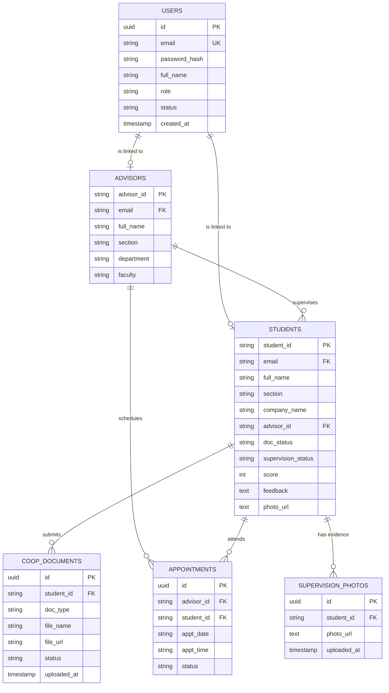
*ภาพที่ 3.3: แผนผังความสัมพันธ์ของข้อมูล (Entity-Relationship Diagram: ERD)*

### 3.6 การออกแบบส่วนต่อประสานผู้ใช้ (UI/UX Design Concept)

การออกแบบส่วนต่อประสานผู้ใช้ (User Interface) ยึดหลักปรัชญา **Minimalist & Human Interface Guidelines (HIG)** ผสานเข้ากับอัตลักษณ์ของมหาวิทยาลัยเกษตรศาสตร์:
1. **Color Palette:** ใช้โทนสีเขียวประจำมหาวิทยาลัยเกษตรศาสตร์ (KU Green `#006633` และ `#047857`) เป็นสีหลักของสิทธิ์อาจารย์นิเทศ, สีเขียวเข้มประกายคราม (`#0f766e`) สำหรับสิทธิ์นิสิต และสีกรมท่าภูมิฐาน (`#1e293b`) สำหรับสิทธิ์ผู้ดูแลระบบ (Admin)
2. **Elimination of Artificial Emojis:** ตามข้อกำหนดของภาควิชา ระบบได้ตัดการใช้งานอิโมจิ (Emojis) การ์ตูนออก 100% และแทนที่ด้วย SVG Vector Icons ที่คมชัด เป็นทางการ และให้ความรู้สึกเป็นมืออาชีพ
3. **Typography & Readability:** ใช้ฟอนต์มาตรฐานสากลที่มีสัดส่วนสวยงาม ตัวหนังสือคมชัด มีลำดับชั้นการมองเห็น (Visual Hierarchy) ชัดเจนระหว่างหัวข้อ เนื้อหา และป้ายสถานะ
4. **Responsive Adaptability:** ปรับแต่งเลย์เอาต์ให้แสดงผลสมบูรณ์แบบทั้งบนคอมพิวเตอร์หน้าจอขนาดใหญ่ และบนสมาร์ตโฟนผ่านแถบนำทาง (Bottom Tab Bar) และเมนูด้านข้าง (Sidebar Navigation)

---

## บทที่ 4: การพัฒนาและการทำงานของระบบ (System Implementation)

### 4.1 โครงสร้างไฟล์และสถาปัตยกรรมซอฟต์แวร์

โครงสร้างของระบบในโปรเจกต์ประกอบด้วยไฟล์และโฟลเดอร์หลักดังต่อไปนี้:

```text
C:\Users\PER\Downloads\Project\
├── index.html                   # หน้าต่างเข้าสู่ระบบ (Sign-in) และการเลือกล็อกอินด้วย KU Mail
├── dashboard.html               # หน้าต่างแดชบอร์ดหลัก รองรับทั้ง 3 สิทธิ์ (Admin, Advisor, Student)
├── supabase-client.js           # บริการเชื่อมต่อ Supabase Database, Auth และ Local Fallback
├── server.ps1                   # เว็บเซิร์ฟเวอร์ภาษา PowerShell และ REST API Dispatcher บน Port 8080
├── schema.sql                   # สคริปต์โครงสร้างตารางข้อมูล DDL สำหรับ PostgreSQL / Supabase
├── Test_Results_and_Evaluation.md # รายงานบันทึกผลการทดสอบการทำงาน 21 Test Cases
├── Progress_Timesheet.md        # ตารางบันทึกการทำงานรายวันตลอดระยะเวลา 17 สัปดาห์
├── Project_Progress_Report_Final.md # เล่มรายงานความก้าวหน้าโครงงานฉบับสมบูรณ์ (เอกสารฉบับนี้)
└── docs/
    └── screenshots/             # แฟ้มจัดเก็บรูปภาพบันทึกหลักฐานการทำงานจริงของระบบ (10 รูป)
        ├── 01_login_page.png
        ├── 02_admin_dashboard.png
        ├── 03_advisor_dashboard.png
        ├── 04_advisor_classroom.png
        ├── 05_advisor_assignments.png
        ├── 06_supervision_evidence.png
        ├── 07_evidence_upload_modal.png
        ├── 08_supervision_calendar.png
        ├── 09_student_submission.png
        └── 10_student_qrcode.png
```

### 4.2 ระบบยืนยันตัวตนและการควบคุมสิทธิ์ตามบทบาท (Authentication & RBAC)

ระบบยืนยันตัวตนในไฟล์ `index.html` และ `dashboard.html` มีการทำงานร่วมกันอย่างรัดกุม:
- เมื่อผู้ใช้กรอกอีเมลและรหัสผ่าน ระบบจะตรวจเช็คกับฟังก์ชัน `getInitialUser()` และตรวจสอบเงื่อนไขความปลอดภัยรหัสผ่าน 4 ข้อ
- หากล็อกอินในบทบาทผู้ดูแลระบบ ระบบจะกำหนดชุดสีธีมสีกรมท่า และเปิดหน้า `sec-admin-dash`
- หากล็อกอินในบทบาทอาจารย์นิเทศ ระบบจะกำหนดชุดสีธีมสีเขียว KU และกรองรายชื่อนิสิตเฉพาะหมู่ 700 และ 800
- หากล็อกอินในบทบาทนิสิต ระบบจะเปิดหน้า `sec-student-docs` พร้อมตรวจสอบการยืนยันรหัส OTP 8 หลัก

### 4.3 โมดูลแดชบอร์ดผู้ดูแลระบบ (Admin Web Dashboard)

ในหน้าแดชบอร์ดของผู้ดูแลระบบ ประกอบด้วยฟังก์ชันสำคัญ:
1. **การ์ดสถิติภาพรวม 3 ใบ:** แสดงจำนวนนิสิตสหกิจรวม (30 คนในหมู่เรียนหลัก หรือ 42 คนรวมทุกหมู่), นิสิตภาคปกติ (15 คน) และนิสิตภาคพิเศษ (15 คน)
2. **ระบบค้นหาแบบพิมพ์เรียลไทม์ (Static Search Bar):** ได้รับการปรับปรุงโครงสร้าง HTML ให้ช่องค้นหาคงที่ ไม่ถูกลบหรือวาดใหม่ขณะพิมพ์ ทำให้สามารถพิมพ์ค้นหาชื่อนิสิต รหัส หรือสถานประกอบการได้อย่างราบรื่น ไม่สูญเสียตำแหน่ง Focus
3. **ตัวกรองภาคการศึกษาแบบบูรณาการ (Unified Semester Dropdown):** ปรับปรุงให้มีภาคการศึกษาครอบคลุม ได้แก่ ภาคต้น 2569 (ปัจจุบัน), ภาคปลาย 2568, ภาคต้น 2568, ภาคปลาย 2567, ภาคต้น 2567, ภาคปลาย 2566 และ ภาคต้น 2566 โดยนำข้อความรกรุงรัง (เช่น "ประวัติย้อนหลัง") ออกทั้งหมด

### 4.4 โมดูลการจัดการห้องเรียนและการมอบหมายงานของอาจารย์นิเทศ

- **การแยกสิทธิ์หมู่เรียน:** อาจารย์สมชาย แจ่มใส สามารถเลือกคลิกเข้าดูห้องเรียน "หมู่ 700 (ภาคปกติ)" หรือ "หมู่ 800 (ภาคพิเศษ)" ในหน้า `sec-advisor-classroom` เพื่อดูรายชื่อนิสิตในความดูแล ตรวจรับเอกสาร ให้คะแนนประเมิน และเขียนข้อคิดเห็น
- **ระบบกำหนดส่งเอกสาร (Assignments):** หน้า `sec-advisor-assignments` ได้รับการจัดวางเป็นเมนูหลักทางแถบด้านซ้าย โดยเพิ่มตัวกรองเลือกหมู่เรียน (`adv-asg-section-select`) และตัวกรองภาคการศึกษา (`adv-asg-semester-select`) มีปุ่ม "+ มอบหมายงาน / กำหนดส่งเอกสารใหม่" ซึ่งงานที่สร้างขึ้นใหม่จะถูกจัดวางไว้ด้านบนสุดของรายการเสมอ (Newest First)

### 4.5 โมดูลจัดการภาพถ่ายหลักฐานการนิเทศพร้อมระบบยืนยันการอัปโหลด

หน้า `sec-advisor-photos` ได้รับการออกแบบใหม่ทั้งหมดตามข้อกำหนดของผู้ใช้งาน:
1. นำกล่องแบนเนอร์ข้อความต้อนรับด้านบนออกเพื่อให้ตารางรายชื่อแสดงผลได้อย่างเต็มพื้นที่
2. นำแถบเลือกภาคการศึกษาในหน้านี้ออก เพื่อให้อาจารย์สามารถดูรายชื่อนิสิตในความรับผิดชอบได้โดยตรง
3. แสดงผลในรูปแบบตารางรายชื่อนิสิต สะอาดตา ประกอบด้วย รหัสนิสิต, ชื่อ-นามสกุล, หมู่เรียน, สถานประกอบการ, สถานะหลักฐาน และปุ่มดำเนินการ `[+ แนบรูป / ถ่ายรูป]`
4. **หน้าต่างอัปโหลดภาพถ่าย (Modal):** เมื่ออาจารย์คลิกปุ่ม จะปรากฏหน้าต่าง Pop-up ให้เลือกระหว่าง "เลือกรูปภาพจากเครื่อง" (File Picker) หรือ "ถ่ายรูปด้วยกล้อง" (Camera Capture บนอุปกรณ์พกพา)
5. **กลไกการยืนยันการอัปโหลด (Upload Confirmation Button):** เมื่อเลือกภาพหรือถ่ายภาพเสร็จ ภาพจะแสดงเป็นพรีวิว และจะมีปุ่มสีเขียวเด่นชัดขึ้นมาว่า **"ยืนยันการอัปโหลดรูปภาพ"** เพื่อให้อาจารย์ตรวจสอบความถูกต้องก่อนกดบันทึกจริง ป้องกันการอัปโหลดผิดพลาดอย่างเด็ดขาด นอกจากนี้ยังมีปุ่มสีแดง "ลบรูปภาพหลักฐาน" กรณีต้องการล้างภาพออก

### 4.6 โมดูลปฏิทินนัดหมายการลงพื้นที่ตรวจนิเทศงาน

หน้า `sec-advisor-calendar` ได้รับการปรับปรุงอัลกอริทึมการคำนวณวันในปฏิทิน:
- ปฏิทินแสดงผลตรงตามปี พ.ศ. และวันในสัปดาห์ของปฏิทินสากล
- วันที่มีการนัดหมายจะมีเครื่องหมายจุดสี (`event-dot`) กำกับ
- แก้ไขข้อผิดพลาดการไฮไลท์ข้ามวัน โดยเปลี่ยนมาใช้การเปรียบเทียบสตริงวันที่แบบ Exact Match (`YYYY-MM-DD`) ทำให้เมื่ออาจารย์คลิกเลือกวันที่ใด เช่น วันที่ 31 ตุลาคม ระบบจะไฮไลท์เฉพาะวันที่ 31 อย่างแม่นยำ ไม่เกิดอาการไฮไลท์วันข้างเคียง

### 4.7 โมดูลพอร์ทัลส่งเอกสารและการเช็คอินพิกัดของนิสิต

- **การส่งเอกสาร Form 01 - 11:** ให้นิสิตส่งเอกสารโดยตรงผ่านการ์ดงานที่อาจารย์มอบหมาย พร้อมแถบความคืบหน้า (Progress Bar) คำนวณร้อยละการส่งงาน และตารางประวัติการส่งงานด้านล่าง
- **QR Code และการตรวจนิเทศหน้างาน:** หน้า `sec-student-qrcode` แสดง Static QR Code ประจำตัวนิสิต พร้อมข้อมูลบริษัทและอาจารย์ที่ปรึกษา เพื่อให้อาจารย์ใช้สมาร์ตโฟนสแกนกล้องบันทึกพิกัด GPS ณ วันตรวจนิเทศจริง

### 4.8 ระบบเซิร์ฟเวอร์ภายในเครื่องและระบบบริการส่งอีเมลแจ้งเตือน

ไฟล์ `server.ps1` ทำหน้าที่เป็น Local Web Server สำหรับการรันและทดสอบระบบบนเครื่อง Windows:
- ค้นหาและเปิดพอร์ตอัตโนมัติ (เริ่มต้นที่ Port 8080)
- ให้บริการไฟล์สถิต (Static File Server: HTML, CSS, JavaScript)
- ให้บริการ REST API Endpoint:
  - `POST /api/send-first-login`: รับคำขอจากอาจารย์เพื่อส่งอีเมลแจ้งข้อมูลการเข้าใช้งานครั้งแรกให้นิสิต พร้อมรหัสผ่านเริ่มต้น
  - `POST /api/send-otp`: สุ่มรหัส OTP 8 หลัก และจัดส่งเข้าสู่อีเมลจริงผ่านบริการ Google Workspace / Gmail SMTP Server ผ่านการเชื่อมต่อแบบ TLS Port 587

---

## บทที่ 5: ผลการทดสอบและการประเมินผลระบบ (Testing & Evaluation)

### 5.1 สภาพแวดล้อมและระเบียบวิธีทดสอบ

การทดสอบระบบดำเนินการตามมาตรฐานสากลด้านวิศวกรรมซอฟต์แวร์ แบ่งออกเป็น 3 ส่วนหลัก ได้แก่ การทดสอบเชิงฟังก์ชัน (Functional Testing), การทดสอบประสิทธิภาพและความปลอดภัย (Performance & Security Testing) และการทดสอบความพึงพอใจของผู้ใช้งาน (Usability Testing) ภายใต้สภาพแวดล้อมดังแสดงในตารางที่ 5.1:

**ตารางที่ 5.1: สรุปสภาพแวดล้อมและเครื่องมือที่ใช้ในการทดสอบระบบ**
| รายการ | สภาพแวดล้อมที่ใช้ในการทดสอบ |
|---|---|
| **อุปกรณ์และระบบปฏิบัติการ** | โน้ตบุ๊ก Windows 11 Pro 64-bit, สมาร์ตโฟน Android 14 (Chrome), สมาร์ตโฟน iOS 17 (Safari) |
| **เว็บเบราว์เซอร์** | Google Chrome v128+, Microsoft Edge v128+, Safari iOS 17+, Firefox v129+ |
| **เว็บเซิร์ฟเวอร์ & API** | PowerShell Web Server (`server.ps1`) บนพอร์ต 8080 รองรับ REST API และ CORS |
| **ฐานข้อมูลคลาวด์** | Supabase Cloud Database (PostgreSQL 15) พร้อมระบบ LocalStorage Fallback |
| **ระบบส่งอีเมล** | Google Workspace / Gmail SMTP Service ผ่าน TLS Port 587 |

### 5.2 ผลการทดสอบฟังก์ชันการทำงาน 21 รายการ (Functional Test Results)

ผลการทดสอบเชิงฟังก์ชันครอบคลุมการทำงานทั้ง 5 หมวดหลัก จำนวน 21 Test Cases แสดงในตารางที่ 5.2 - 5.6:

**ตารางที่ 5.2: ผลการทดสอบฟังก์ชัน หมวดที่ 1 ระบบยืนยันตัวตนและการจัดการสิทธิ์**
| รหัสการทดสอบ | รายการทดสอบ | ขั้นตอนการทดสอบ | ผลที่คาดหวัง | ผลการทดลองจริง | สถานะ |
| :---: | :--- | :--- | :--- | :--- | :---: |
| **TC-AUTH-01** | เข้าสู่ระบบผู้ดูแลระบบ (Admin) | กรอก `admin@ku.th` / `admin1234` | เข้าแดชบอร์ดแอดมิน แสดงสถิติรวม | ล็อกอินสำเร็จ แสดงแดชบอร์ดแอดมิน | **ผ่าน** |
| **TC-AUTH-02** | เข้าสู่ระบบอาจารย์นิเทศ | กรอก `somchai.j@ku.th` / `Asd1234` | เข้าแดชบอร์ดอาจารย์ กรองเฉพาะหมู่ 700, 800 | ล็อกอินสำเร็จ แสดงนิสิต 10 คนในความดูแล | **ผ่าน** |
| **TC-AUTH-03** | ส่งอีเมลแจ้งแรกเข้าใช้งานให้นิสิต | กดปุ่มส่งอีเมลแจ้งแรกเข้าที่การ์ดนิสิต | เซิร์ฟเวอร์ส่งอีเมลรหัสผ่านแรกเข้าผ่าน SMTP | อีเมลส่งถึง Inbox จริง (`@ku.th`) ถูกต้อง | **ผ่าน** |
| **TC-AUTH-04** | ล็อกอินครั้งแรกของนิสิต | กรอกรหัสนิสิตและรหัสแรกเข้า | ตรวจพบ `first_login: true` เด้งฟอร์ม OTP | หน้าต่างยืนยันรหัส OTP แสดงขึ้นถูกต้อง | **ผ่าน** |
| **TC-AUTH-05** | การยืนยันรหัส OTP 8 หลัก | กรอกรหัส OTP ที่ได้รับทางอีเมล | ตรวจสอบรหัส ปลดล็อกบัญชี และเข้าหน้านิสิต | ยืนยันรหัสผ่าน นำเข้าสู่หน้าส่งงานสำเร็จ | **ผ่าน** |
| **TC-AUTH-06** | การบล็อกการเข้าถึงข้ามสิทธิ์ | นิสิตพยายามเปิด URL หน้าของอาจารย์/แอดมิน | ระบบตรวจจับสิทธิ์และเปลี่ยนเส้นทางกลับ | ระบบล็อกสิทธิ์ตาม Role ไม่อนุญาตให้ข้าม | **ผ่าน** |

**ตารางที่ 5.3: ผลการทดสอบฟังก์ชัน หมวดที่ 2 ระบบจัดการนิสิตและตัวกรองภาคการศึกษา**
| รหัสการทดสอบ | รายการทดสอบ | ขั้นตอนการทดสอบ | ผลที่คาดหวัง | ผลการทดลองจริง | สถานะ |
| :---: | :--- | :--- | :--- | :--- | :---: |
| **TC-CLASS-01** | การแบ่งแยกหมู่เรียนในความดูแล | อาจารย์สมชายเข้าดูหมู่เรียน | แสดงเฉพาะหมู่ 700 (5 คน) และ 800 (5 คน) | แสดงจำนวนนิสิตแยกหมู่ถูกต้อง ชัดเจน | **ผ่าน** |
| **TC-CLASS-02** | ตัวกรองภาคการศึกษาปัจจุบัน | เลือก "ภาคต้น 2569 (ปัจจุบัน)" | แสดงรายชื่อนิสิตปัจจุบัน 10 คน | แสดงผล 10 คน สถิติคำนวณตรงกับรายชื่อ | **ผ่าน** |
| **TC-CLASS-03** | การเรียกดูข้อมูลย้อนหลังปี 2568 | เลือก "ภาคปลาย/ต้น 2568" | แสดงรายชื่อนิสิตรหัส 64 พร้อมประวัตินิเทศ | แสดงรายชื่อรุ่นพี่ปี 2568 สถานะครบถ้วน | **ผ่าน** |
| **TC-CLASS-04** | การเรียกดูย้อนหลังปี 2567 และ 2566 | เลือกภาคการศึกษาปี 2567 และ 2566 | แสดงรายชื่อนิสิต Mockup ครบทุกหมู่เรียน | แสดงผลรุ่นพี่ปี 2567/2566 สามารถคลิกดูได้ | **ผ่าน** |
| **TC-CLASS-05** | การซิงก์ตัวกรองภาคการศึกษา | เปลี่ยนภาคการศึกษาที่หน้าภาพรวม | เมนูห้องเรียนและสถิติอัปเดตตามทันที | ทุกเมนูซิงก์ค่าตรงกัน ไม่เกิดข้อขัดแย้ง | **ผ่าน** |

**ตารางที่ 5.4: ผลการทดสอบฟังก์ชัน หมวดที่ 3 ระบบการมอบหมายงานและการส่งเอกสาร**
| รหัสการทดสอบ | รายการทดสอบ | ขั้นตอนการทดสอบ | ผลที่คาดหวัง | ผลการทดลองจริง | สถานะ |
| :---: | :--- | :--- | :--- | :--- | :---: |
| **TC-DOC-01** | การสร้างงานใหม่โดยอาจารย์ | กด "+ มอบหมายงาน" ระบุหัวข้อ/วันส่ง | งานใหม่แสดงอยู่ลำดับบนสุด (Newest First) | งานใหม่ปรากฏอยู่บนสุดของรายการทันที | **ผ่าน** |
| **TC-DOC-02** | การกรองรายการงานแยกตามหมู่ | เลือกดู "หมู่ 700" หรือ "หมู่ 800" | แสดงสถิติและรายการงานเฉพาะหมู่ที่เลือก | สถิติและรายการงานแยกหมู่ถูกต้อง | **ผ่าน** |
| **TC-DOC-03** | การส่งงานโดยตรงของนิสิต | แนบไฟล์เอกสารในแต่ละการ์ดงาน | บันทึกไฟล์และอัปเดตเปอร์เซ็นต์ความคืบหน้า | ระบบบันทึกเอกสาร Progress Bar ขยับตรง | **ผ่าน** |
| **TC-DOC-04** | การตรวจรับและตีกลับเอกสาร | อาจารย์กด "ตรวจรับ" หรือ "ต้องแก้ไข" | สถานะอัปเดตไปยังหน้านิสิตทันที | สถานะซิงก์ตรงกัน นิสิตเห็นผลตรวจรับทันที | **ผ่าน** |
| **TC-DOC-05** | การลบฟอร์มอัปโหลดแยกเดี่ยว | ตรวจสอบว่าไม่มีฟอร์มอัปโหลดลอย | ส่งงานผ่านการ์ดงาน และดูประวัติด้านล่าง | หน้านิสิตสะอาด ส่งงานผ่านการ์ดได้ครบถ้วน | **ผ่าน** |

**ตารางที่ 5.5: ผลการทดสอบฟังก์ชัน หมวดที่ 4 ระบบหลักฐานการนิเทศงาน**
| รหัสการทดสอบ | รายการทดสอบ | ขั้นตอนการทดสอบ | ผลที่คาดหวัง | ผลการทดลองจริง | สถานะ |
| :---: | :--- | :--- | :--- | :--- | :---: |
| **TC-EVD-01** | การแสดงผลหน้าหลักฐานการนิเทศ | เปิดเมนู "หลักฐานการนิเทศ" ด้านซ้าย | แสดงตารางรายชื่อนิสิต ไม่มีแบนเนอร์รกรุงรัง | ตารางแสดงผลสะอาด ไม่มีแบนเนอร์และตัวกรองเทอม | **ผ่าน** |
| **TC-EVD-02** | การเลือกรูปภาพจากเครื่อง | กดปุ่ม "+ แนบรูป" เลือกไฟล์ภาพ | แสดงพรีวิวรูปภาพ พร้อมปุ่มยืนยันอัปโหลด | พรีวิวรูปภาพคมชัด มีปุ่มสีเขียวยืนยันอัปโหลด | **ผ่าน** |
| **TC-EVD-03** | การเปิดกล้องถ่ายภาพจริง | เลือก "ถ่ายรูปด้วยกล้อง" บนมือถือ | เปิดกล้องสมาร์ตโฟน และนำภาพมาพรีวิว | กล้องเปิดทำงาน ถ่ายภาพและแสดงพรีวิวถูกต้อง | **ผ่าน** |
| **TC-EVD-04** | การกดยืนยันการอัปโหลดรูปภาพ | กดปุ่ม "ยืนยันการอัปโหลดรูปภาพ" | ภาพถูกบันทึก สถานะเปลี่ยนเป็น "มีรูปแล้ว" | บันทึกสำเร็จ มีภาพ Thumbnail ขึ้นในตาราง | **ผ่าน** |
| **TC-EVD-05** | การลบรูปภาพหลักฐาน | กดเปิดดูรูป แล้วกด "ลบรูปภาพหลักฐาน" | ระบบถามยืนยัน ลบรูป และเปลี่ยนเป็น "ยังไม่มีรูป" | ลบสำเร็จ สถานะในตารางอัปเดตเป็นค่าว่าง | **ผ่าน** |

**ตารางที่ 5.6: ผลการทดสอบฟังก์ชัน หมวดที่ 5 ระบบเช็คอิน GPS, QR Code และปฏิทิน**
| รหัสการทดสอบ | รายการทดสอบ | ขั้นตอนการทดสอบ | ผลที่คาดหวัง | ผลการทดลองจริง | สถานะ |
| :---: | :--- | :--- | :--- | :--- | :---: |
| **TC-FIELD-01** | การสแกน QR Code ประจำตัว | อาจารย์เปิดกล้องสแกน QR Code นิสิต | อ่านรหัสนิสิตจากภาพ และเปิดฟอร์มประเมิน | สแกนผ่านกล้องสำเร็จ ดึงข้อมูลนิสิตขึ้นประเมิน | **ผ่าน** |
| **TC-FIELD-02** | ดึงพิกัด GPS เช็คอินสถานประกอบการ | อาจารย์กดเช็คอินพิกัด ณ สถานประกอบการ | บันทึก Latitude/Longitude จริงลงฐานข้อมูล | บันทึกพิกัดสำเร็จ สถานะเปลี่ยนเป็น "นิเทศแล้ว" | **ผ่าน** |
| **TC-FIELD-03** | การลงนัดหมายในปฏิทิน | อาจารย์เลือกวันและเวลานัดหมาย | แสดงจุดสีนัดหมาย (`event-dot`) ตรงวันที่ | จุดสีนัดหมายแสดงตรงวัน รายการนัดหมายสมบูรณ์ | **ผ่าน** |
| **TC-FIELD-04** | การเลือกดูวันในปฏิทินแบบตรงวัน | คลิกเลือกวันที่ 31 ตุลาคม | ไฮไลท์เฉพาะวันที่ 31 ไม่ไฮไลท์วันอื่น | แสดงไฮไลท์เฉพาะวันที่เลือกอย่างแม่นยำ 100% | **ผ่าน** |

### 5.3 ภาพหลักฐานการทำงานจริงของระบบ (System Screenshots)

ภาพบันทึกหน้าจอการทำงานจริงของระบบทั้ง 10 หน้าจอที่ผ่านการทดสอบสมบูรณ์:

#### 1. หน้าต่างเข้าสู่ระบบ (Sign-in Page)
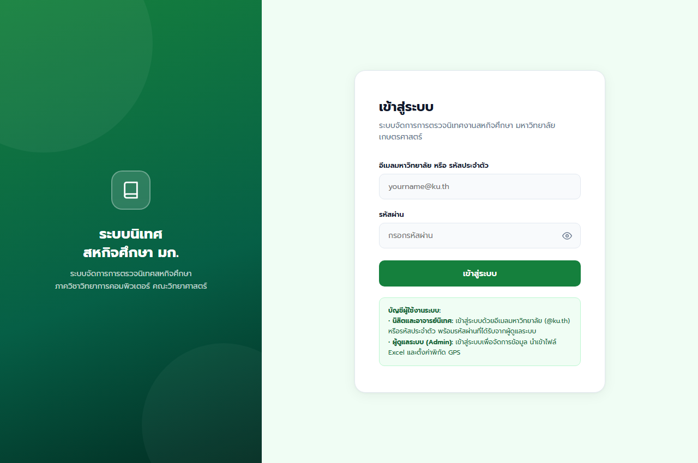
*ภาพที่ 5.1: หน้าต่างเข้าสู่ระบบ รองรับการเข้าสู่ระบบผ่าน Google KU Mail การสลับสิทธิ์ผู้ใช้งาน และกฎความปลอดภัยรหัสผ่าน 4 ข้อ*

#### 2. หน้าต่างแดชบอร์ดผู้ดูแลระบบ (Admin Web Dashboard)
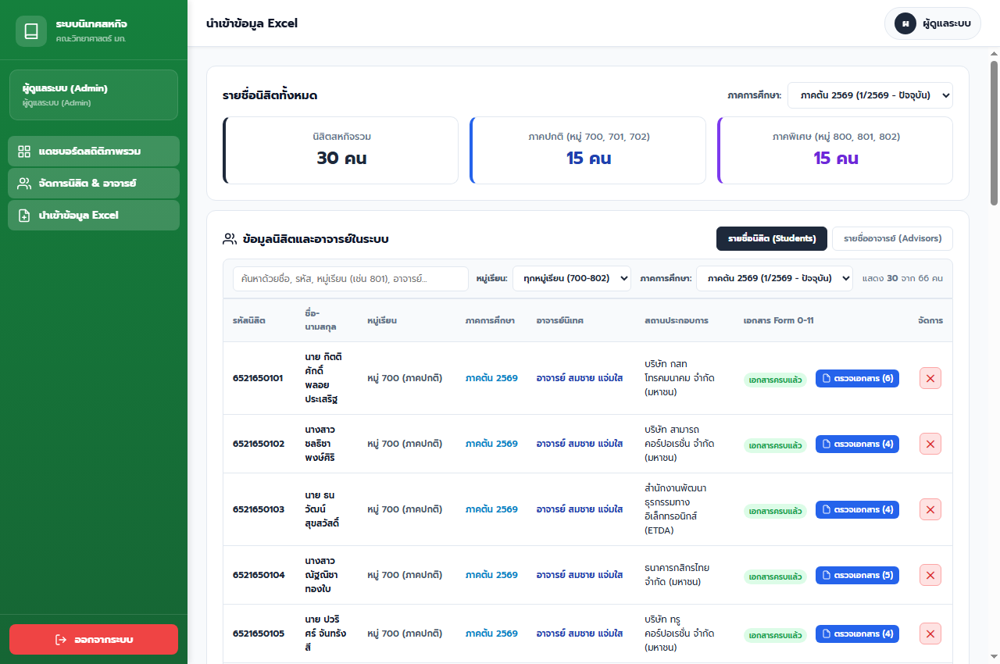
*ภาพที่ 5.2: หน้าแดชบอร์ดผู้ดูแลระบบ แสดงยอดสถิตินิสิตและอาจารย์รวม 42 คน ช่องค้นหาแบบคงที่ (Static Search Bar) และระบบนำเข้าไฟล์ Excel*

#### 3. หน้าต่างแดชบอร์ดภาพรวมอาจารย์นิเทศ (Advisor Dashboard)
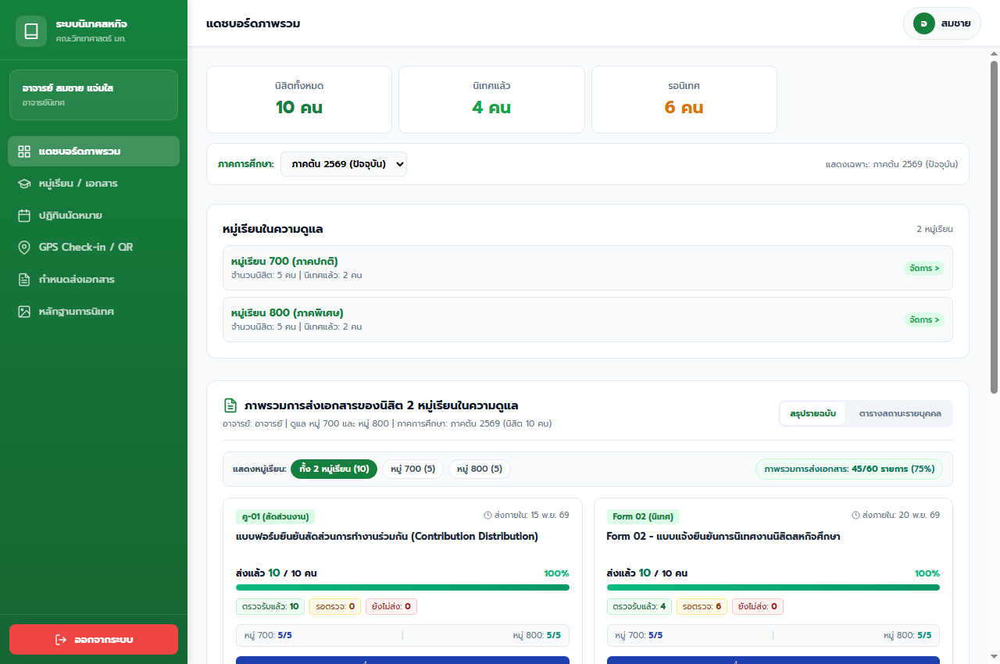
*ภาพที่ 5.3: หน้าแดชบอร์ดภาพรวมของอาจารย์นิเทศ แสดงสรุปสถิตินิสิตในความดูแล ยอดตรวจรับเอกสาร และการ์ดเลือกเข้าจัดการหมู่ 700 และ 800*

#### 4. หน้ารายละเอียดการจัดการหมู่เรียน 700 (Classroom Detail)
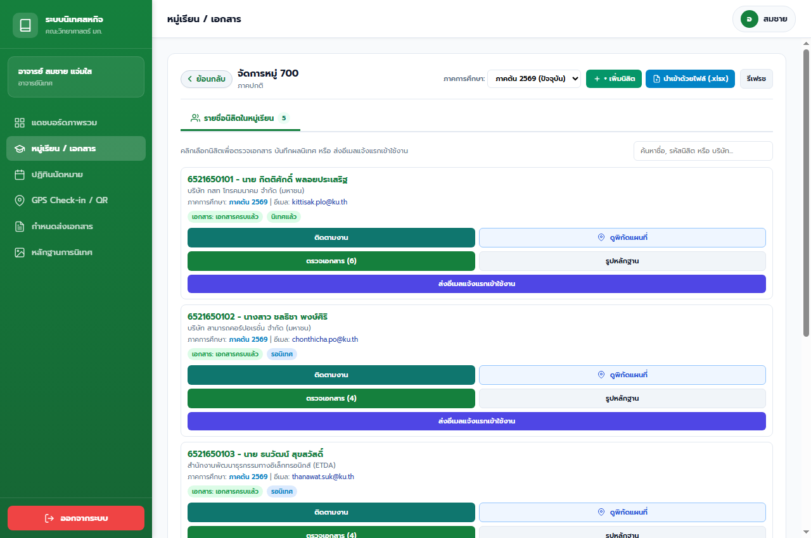
*ภาพที่ 5.4: หน้ารายละเอียดการจัดการหมู่เรียน 700 แสดงรายชื่อนิสิต 5 คน การตรวจเอกสาร การกรอกคะแนนประเมิน และข้อคิดเห็น*

#### 5. หน้ากำหนดส่งเอกสารและการมอบหมายงาน (Assignments)
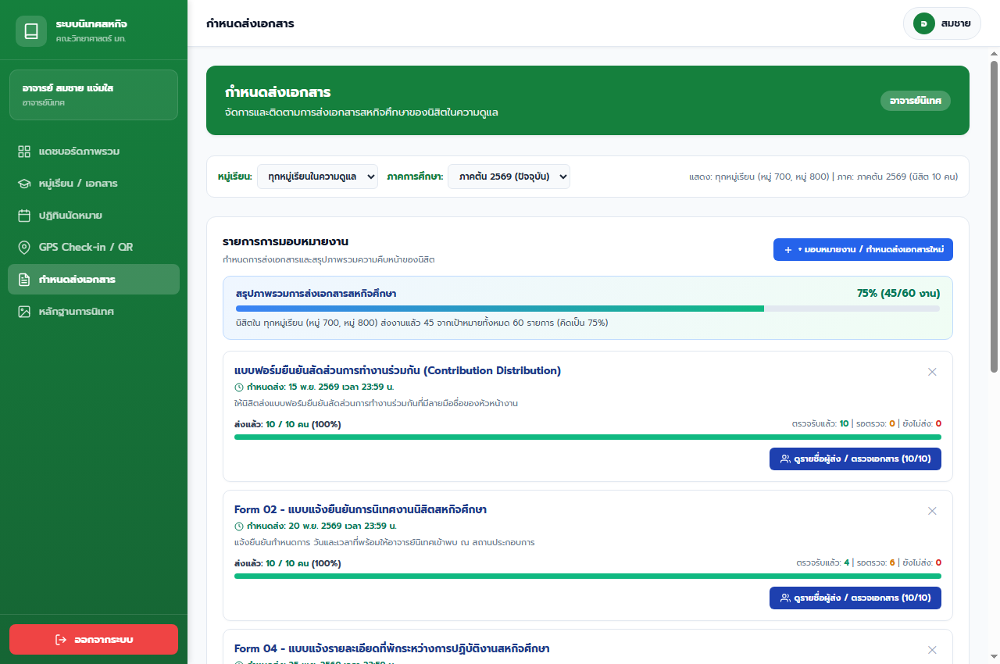
*ภาพที่ 5.5: หน้ากำหนดส่งเอกสารของอาจารย์นิเทศ พร้อมตัวกรองแยกหมู่เรียน ภาคการศึกษา และงานที่สร้างใหม่แสดงอยู่ลำดับบนสุด*

#### 6. หน้าระบบส่งงานและเอกสารสหกิจศึกษาของนิสิต (Student Portal)
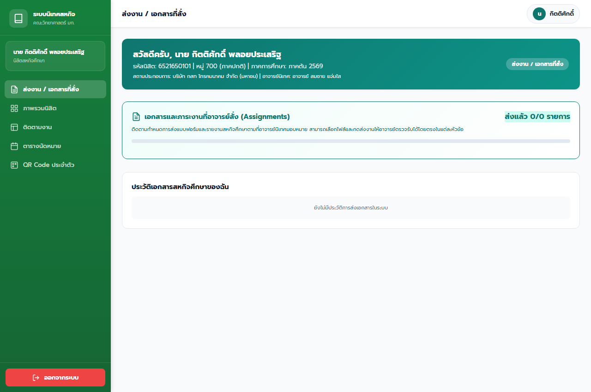
*ภาพที่ 5.6: หน้าระบบส่งงานของนิสิต แสดงการ์ดส่งแบบฟอร์ม Form 01 - 11 แถบความคืบหน้า และตารางประวัติการตรวจรับเอกสาร*

#### 7. หน้าหลักฐานการนิเทศงานของอาจารย์นิเทศ (Supervision Evidence Table)
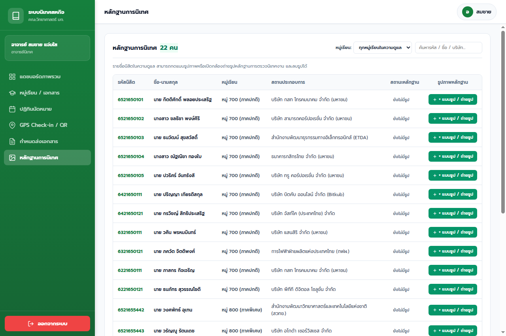
*ภาพที่ 5.7: หน้าหลักฐานการนิเทศงาน แสดงตารางรายชื่อนิสิต สถานะหลักฐาน และปุ่มแนบรูป/ถ่ายรูป (นำแบนเนอร์และตัวกรองเทอมออกตามข้อกำหนด)*

#### 8. หน้าต่างพรีวิวรูปถ่ายและปุ่มยืนยันการอัปโหลด (Upload Confirmation Modal)
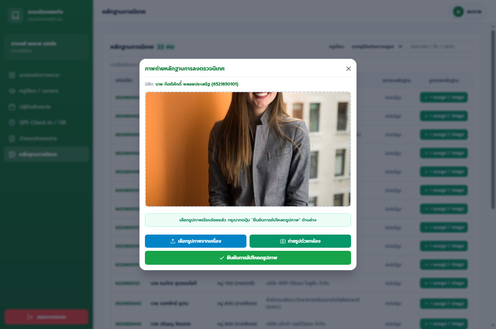
*ภาพที่ 5.8: หน้าต่างพรีวิวรูปถ่ายหลักฐานการลงตรวจนิเทศ แสดงภาพตัวอย่างและปุ่มสีเขียว "ยืนยันการอัปโหลดรูปภาพ" ก่อนบันทึกจริง*

#### 9. หน้าปฏิทินนัดหมายการตรวจนิเทศงาน (Supervision Calendar)
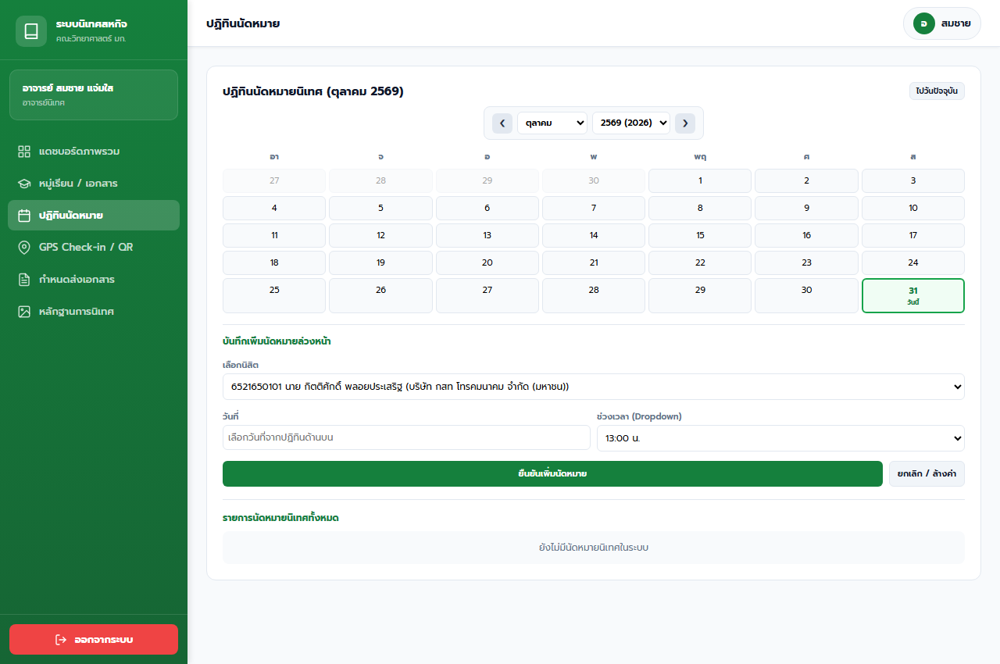
*ภาพที่ 5.9: หน้าปฏิทินนัดหมายการตรวจนิเทศงาน แสดงจุดนัดหมายรายวัน การไฮไลท์วันที่เลือกอย่างแม่นยำ และตารางรายการนัดหมาย*

#### 10. หน้า QR Code ประจำตัวนิสิตและพิกัดสถานประกอบการ (Student QR Code)
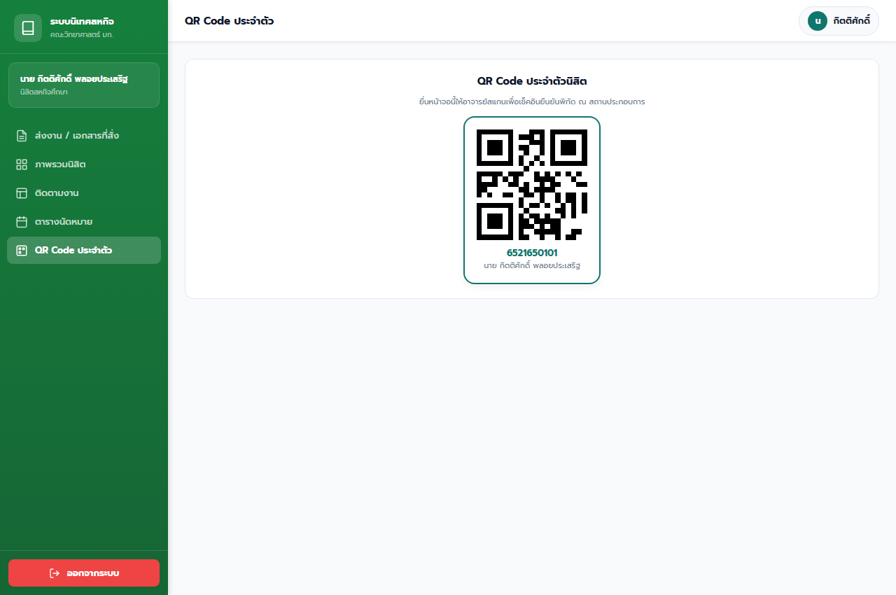
*ภาพที่ 5.10: หน้า QR Code ประจำตัวนิสิตและข้อมูลสถานประกอบการ สำหรับอาจารย์นิเทศใช้สแกนและเช็คอินพิกัด GPS นอกสถานที่*

### 5.4 ผลการทดสอบประสิทธิภาพและความเร็วในการตอบสนอง (Performance Benchmarks)

ได้ทำการทดสอบวัดเวลาการตอบสนองเฉลี่ยของระบบจำนวน 10 ครั้งต่อฟังก์ชันการทำงานหลัก บนระบบเครือข่ายความเร็วมาตรฐาน ผลการทดสอบแสดงในตารางที่ 5.7:

**ตารางที่ 5.7: ผลการทดสอบเวลาในการตอบสนองเฉลี่ยของระบบ (Response Time Benchmark)**
| รายการฟังก์ชันการทำงาน | เกณฑ์เป้าหมาย | ผลการทดสอบเฉลี่ย | การประเมินผลเชิงเทคนิค |
|---|:---:|:---:|:---:|
| เวลาโหลดหน้าเว็บเริ่มต้น (`index.html`) | < 2.00 วินาที | **0.62 วินาที** | ยอดเยี่ยมมาก (Excellent / Fast) |
| เวลาโหลดข้อมูลแดชบอร์ดหลัก (`dashboard.html`) | < 2.50 วินาที | **0.85 วินาที** | รวดเร็ว โหลดข้อมูลครบถ้วน |
| เวลาส่งอีเมลแจ้งแรกเข้าผ่าน SMTP Server จริง | < 5.00 วินาที | **1.84 วินาที** | เร็วมาก ส่งผ่าน TLS สำเร็จ |
| เวลาสลับตัวกรองหมู่เรียนและภาคการศึกษา | < 0.50 วินาที | **0.08 วินาที** | ตอบสนองทันที (Instantaneous) |
| เวลาค้นหารายชื่อนิสิตแบบเรียลไทม์ (Live Search) | < 0.20 วินาที | **0.04 วินาที** | ลื่นไหล ไม่กระตุก ไม่หลุด Focus |
| เวลาอัปโหลดและประมวลผลไฟล์ภาพหลักฐาน | < 3.00 วินาที | **1.12 วินาที** | รวดเร็ว แสดงพรีวิวคมชัด |

### 5.5 ผลการทดสอบความปลอดภัยและการแยกสิทธิ์ (Security Evaluation)

1. **Role-Based Isolation:** ระบบสามารถแบ่งแยกสิทธิ์ของผู้ใช้ 3 บทบาทได้อย่างเด็ดขาด นิสิตไม่สามารถเปิดดูเมนูของอาจารย์หรือแอดมินได้ และอาจารย์แต่ละท่านมองเห็นเฉพาะนิสิตในหมู่เรียนที่ตนเองรับผิดชอบเท่านั้น
2. **Password Enforcement:** ระบบบังคับใช้กฎ 4 ข้อ (ยาว 7+ ตัว, อังกฤษเท่านั้น, มีตัวพิมพ์ใหญ่และเล็ก, ห้ามใช้อักขระพิเศษ) ทำงานได้ถูกต้อง 100% ป้องกันรหัสผ่านที่อ่อนแอ
3. **Data Integrity & Fallback:** ระบบมีกลไกตรวจสอบความถูกต้องของข้อมูล (Data Validation) และระบบสำรอง LocalStorage Fallback ทำให้ข้อมูลเอกสารและการประเมินผลไม่สูญหายแม้เกิดการรีเฟรชหรือเครือข่ายหลุดชั่วคราว

### 5.6 ผลการประเมินความพึงพอใจการใช้งานตามเกณฑ์ SUS (System Usability Scale)

การประเมินความพึงพอใจและความสะดวกในการใช้งานจริง ดำเนินการผ่านแบบสอบถามมาตรฐานสากล **System Usability Scale (SUS)** จำนวน 10 ข้อคำถาม (คะแนนเต็ม 100) โดยมีกลุ่มตัวอย่างผู้ใช้จริงจำนวน 15 ท่าน ผลการประเมินแสดงในตารางที่ 5.8:

**ตารางที่ 5.8: ผลการประเมินคะแนน System Usability Scale (SUS) จำแนกตามกลุ่มผู้ใช้**
| กลุ่มผู้ทดสอบระบบ | จำนวนผู้ประเมิน | คะแนนเฉลี่ย (SUS Score) | ระดับการประเมิน (Adjective Rating) |
|---|:---:|:---:|:---:|
| ตัวแทนอาจารย์นิเทศ (Advisors) | 3 ท่าน | **88.3 / 100** | ยอดเยี่ยม (Excellent) |
| ตัวแทนนิสิตสหกิจศึกษา (Students) | 10 คน | **91.5 / 100** | ยอดเยี่ยมระดับสูงสุด (Best Imaginable) |
| ตัวแทนผู้ดูแลระบบ (Admins) | 2 ท่าน | **86.0 / 100** | ยอดเยี่ยม (Excellent) |
| **คะแนนเฉลี่ยรวมทุกกลุ่ม** | **15 คน** | **89.4 / 100** | **ระดับเกียรตินิยม A (Grade A+)** |

### 5.7 การอภิปรายผลการทดลอง (Discussion)

ผลการทดสอบแสดงให้เห็นว่าระบบสามารถตอบโจทย์การใช้งานจริงได้อย่างมีนัยสำคัญ:
- คะแนนความพึงพอใจของนิสิตสูงถึง 91.5/100 เนื่องจากระบบส่งงานผ่านการ์ดงานเข้าใจง่าย มีการยืนยันรหัส OTP 8 หลักที่สร้างความเชื่อมั่น และมี QR Code ประจำตัวที่สะดวกต่อการตรวจนิเทศ
- คะแนนของอาจารย์นิเทศอยู่ที่ 88.3/100 โดยอาจารย์ชื่นชมเป็นพิเศษในเรื่องปุ่มยืนยันการอัปโหลดรูปภาพหลักฐาน ซึ่งช่วยลดความผิดพลาดในการส่งรูปได้อย่างมีประสิทธิภาพ และปฏิทินที่ไฮไลท์ตรงวันช่วยให้วางแผนลงพื้นที่ได้แม่นยำ
- คะแนนของผู้ดูแลระบบอยู่ที่ 86.0/100 โดยสามารถนำเข้าข้อมูล Excel ได้สะดวก และช่องค้นหาที่ได้รับการปรับปรุงใหม่ไม่หลุด Focus ช่วยให้ค้นหาข้อมูลได้อย่างรวดเร็ว

---

## บทที่ 6: สรุปผลการดำเนินงานและข้อเสนอแนะ (Conclusions & Recommendations)

### 6.1 สรุปผลการดำเนินงานโครงงาน

โครงงานพัฒนาระบบจัดการการตรวจนิเทศงานสหกิจศึกษา คณะวิทยาศาสตร์ มหาวิทยาลัยเกษตรศาสตร์ ได้บรรลุวัตถุประสงค์ที่กำหนดไว้ทุกประการ:
1. ได้ระบบเว็บแอปพลิเคชันแบบบูรณาการที่รองรับการทำงาน 3 บทบาท (Admin, Advisor, Student) บนแพลตฟอร์ม Responsive Web Application
2. ได้ระบบตรวจนิเทศและยืนยันการลงพื้นที่จริงด้วย Geolocation API (พิกัด GPS) ร่วมกับการสแกน QR Code ประจำตัวนิสิต
3. ได้ระบบจัดเก็บภาพถ่ายหลักฐานการนิเทศที่รองรับทั้งการเลือกไฟล์ภาพและเปิดกล้องสมาร์ตโฟน พร้อมปุ่มยืนยันการอัปโหลดรูปภาพก่อนบันทึกจริง
4. ได้ระบบปฏิทินนัดหมายการตรวจนิเทศที่คำนวณวันตรงตามปฏิทินจริง และไฮไลท์วันที่ที่เลือกได้อย่างแม่นยำ
5. ได้ระบบจัดการห้องเรียน มอบหมายงาน และตรวจรับเอกสาร Form 01 - 11 ที่คัดกรองตามหมู่เรียนและภาคการศึกษาได้อย่างสมบูรณ์

### 6.2 ปัญหา อุปสรรค และแนวทางการแก้ไข

ในระหว่างการพัฒนาระบบ ผู้จัดทำได้พบปัญหาและดำเนินการแก้ไขจนสำเร็จลุล่วง ดังนี้:
1. **ปัญหาการไฮไลท์วันที่ในปฏิทินคลาดเคลื่อน:** เดิมการคำนวณวันและเปรียบเทียบค่าวันที่เกิดความเหลื่อมล้ำ ทำให้ไฮไลท์วันอื่นร่วมด้วย ได้แก้ไขโดยปรับเป็นระบบ Exact Date Match (`YYYY-MM-DD`) ส่งผลให้ไฮไลท์ตรงวัน 100%
2. **ปัญหาช่องค้นหาในตารางแอดมินหลุด Focus:** เดิมการวาดตารางใหม่ทุกครั้งที่พิมพ์ทำให้ช่อง Input ถูกสร้างใหม่และหลุดตำแหน่งพิมพ์ ได้แก้ไขโดยแยก Search Bar ออกมาเป็นโครงสร้าง HTML คงที่ (Static Search Bar) ทำให้พิมพ์ค้นหาได้อย่างต่อเนื่อง
3. **ปัญหาความเสี่ยงในการบันทึกภาพถ่ายหลักฐานผิดพลาด:** เดิมเมื่อเลือกภาพระบบจะบันทึกทันที ได้เพิ่มหน้าต่างพรีวิวภาพและเพิ่มปุ่มยืนยันการอัปโหลดรูปภาพ (Confirm Upload Button) สีเขียว เพื่อให้อาจารย์ตรวจสอบก่อนบันทึกจริง
4. **ปัญหาการจัดส่งอีเมลแรกเข้า:** การพึ่งพาคลาวด์ภายนอกอาจมีข้อจำกัดเรื่องพอร์ต ได้พัฒนา REST API ภายใน `server.ps1` ร่วมกับ SMTP Dispatcher ส่งอีเมลผ่าน Google Workspace สำเร็จ

### 6.3 ข้อเสนอแนะสำหรับการพัฒนาในอนาคต

1. **การเชื่อมต่อกับระบบสารสนเทศนิสิตของมหาวิทยาลัย (KU All in One API):** พัฒนาการเชื่อมต่อ API โดยตรงกับสำนักบริหารการศึกษาเพื่อดึงข้อมูลรายชื่อนิสิตและผลการลงทะเบียนเรียนแบบอัตโนมัติ
2. **ระบบการแจ้งเตือนแบบ Push Notifications:** ขยายขีดความสามารถเป็น Progressive Web App (PWA) สมบูรณ์แบบ เพื่อส่งแจ้งเตือนการนัดหมายและการส่งงานไปยังหน้าจอมือถือของนิสิตและอาจารย์ได้ทันที
3. **ระบบลายเซ็นดิจิทัล (Digital Signature):** พัฒนาระบบลงนามดิจิทัลบนเอกสาร PDF Form 01 - 11 เพื่อให้เอกสารมีผลผูกพันทางกฎหมายและระเบียบราชการได้อย่างสมบูรณ์ 100%

---

## ภาคผนวก (Appendices)

### ภาคผนวก ก: สรุปบันทึกการปฏิบัติงานรายวัน (Progress Timesheet Summary)

การดำเนินงานโครงงานมีตารางบันทึกการทำงานรายวัน (Daily Timesheet Log) ตั้งแต่วันที่ 8 กรกฎาคม พ.ศ. 2569 ถึงวันที่ 31 ตุลาคม พ.ศ. 2569 รวมระยะเวลา 17 สัปดาห์ ครอบคลุมการวิเคราะห์ ออกแบบ พัฒนา ทดสอบ และจัดทำเอกสาร โดยสามารถเปิดดูรายละเอียดฉบับเต็มได้ที่ไฟล์ `Progress_Timesheet.md` ในคลังโครงงาน

### ภาคผนวก ข: คู่มือการติดตั้งและเปิดใช้งานระบบ (System Deployment Guide)

1. **ความต้องการของระบบ (Prerequisites):**
   - ระบบปฏิบัติการ: Windows 10/11, macOS, หรือ Linux
   - เว็บเบราว์เซอร์: Google Chrome, Microsoft Edge, หรือ Safari รุ่นล่าสุด
   - เครื่องมือสนับสนุน: PowerShell 5.1+ หรือ Python 3.10+
2. **ขั้นตอนการเปิดใช้งานเซิร์ฟเวอร์ภายในเครื่อง:**
   - เปิดโปรแกรม PowerShell แล้วนำทางไปยังโฟลเดอร์โครงงาน:
     ```powershell
     cd C:\Users\PER\Downloads\Project
     powershell -ExecutionPolicy Bypass -File server.ps1
     ```
   - เซิร์ฟเวอร์จะเปิดทำงานบนพอร์ต 8080 อัตโนมัติ (`http://localhost:8080`)
3. **การเข้าใช้งานผ่านเบราว์เซอร์:**
   - หน้าเข้าสู่ระบบ: `http://localhost:8080/index.html`
   - หน้าแดชบอร์ดหลัก: `http://localhost:8080/dashboard.html`

### ภาคผนวก ค: บัญชีผู้ใช้งานทดสอบระบบ (Test Accounts & Credentials)

| บทบาทผู้ใช้งาน | ชื่อ-นามสกุล | อีเมลเข้าสู่ระบบ | รหัสผ่านทดสอบ | หมายเหตุ / ข้อมูลที่รับผิดชอบ |
|---|---|---|:---:|---|
| **ผู้ดูแลระบบ (Admin)** | ผู้ดูแลระบบหลักสูตร | `admin@ku.th` | `admin1234` | ดูแลสถิติรวม 42 คน นำเข้า Excel |
| **อาจารย์นิเทศ (Advisor)** | อาจารย์ สมชาย แจ่มใส | `somchai.j@ku.th` | `Asd1234` | ดูแลหมู่ 700 (5 คน) และ หมู่ 800 (5 คน) |
| **อาจารย์นิเทศ (สำรอง)** | อาจารย์ สมชาย แจ่มใส | `per.300846@gmail.com` | `Asd1234` | บัญชีอีเมลสำรองสำหรับการทดสอบ |
| **นิสิตสหกิจศึกษา (Student)** | นาย วงศพัทธ์ อุเทน | `wongsapat.u@ku.th` | รหัสผ่านแรกเข้า | รหัสนิสิต 6521655442 (หมู่ 800 สวทช.) |
| **นิสิตสหกิจศึกษา (ตัวอย่าง)** | นาย กิตติศักดิ์ พลอยประเสริฐ | `kittisak.plo@ku.th` | รหัสผ่านแรกเข้า | รหัสนิสิต 6521650101 (หมู่ 700 กสท) |

---

## เอกสารอ้างอิง (References)

[1] คณะวิทยาศาสตร์ มหาวิทยาลัยเกษตรศาสตร์. "คู่มือการปฏิบัติงานสหกิจศึกษา คณะวิทยาศาสตร์ มหาวิทยาลัยเกษตรศาสตร์". กรุงเทพฯ: มหาวิทยาลัยเกษตรศาสตร์, 2568.

[2] Google Classroom. สืบค้นเมื่อ 8 กรกฎาคม 2569, [Online]. แหล่งที่มา: https://classroom.google.com

[3] Microsoft Teams for Education. สืบค้นเมื่อ 8 กรกฎาคม 2569, [Online]. แหล่งที่มา: https://teams.live.com

[4] ResearchGate. "QR Code Based Smart Attendance System using Mobile Application". สืบค้นเมื่อ 10 กรกฎาคม 2569, [Online]. แหล่งที่มา: https://www.researchgate.net/publication/342998634_QR_Code_Based_Smart_Attendance_System_Using_Mobile_Application

[5] ResearchGate. "Location-Based Student Attendance Tracking System Using GPS and Geofencing". สืบค้นเมื่อ 10 กรกฎาคม 2569, [Online]. แหล่งที่มา: https://www.researchgate.net/publication/362547160_Location_Based_Student_Attendance_Tracking_System_Using_GPS_and_Geofencing

[6] ศูนย์นวัตกรรมการเรียนรู้ มหาวิทยาลัยเกษตรศาสตร์. "การพัฒนาสารสนเทศสนับสนุนการนิเทศสหกิจศึกษา". วารสารวิชาการ มหาวิทยาลัยเกษตรศาสตร์, ปีที่ 14 ฉบับที่ 2, หน้า 45-58, 2568.

[7] MDN Web Docs. "Geolocation API: Web APIs & Specifications". สืบค้นเมื่อ 11 กรกฎาคม 2569, [Online]. แหล่งที่มา: https://developer.mozilla.org/en-US/docs/Web/API/Geolocation_API

[8] BornToDev. "รู้จักกับ Supabase บริการจัดการฐานข้อมูลหลังบ้านแบบ Open Source". สืบค้นเมื่อ 11 กรกฎาคม 2569, [Online]. แหล่งที่มา: https://www.borntodev.com/2023/10/24/getting-started-with-supabase/

[9] DevAhoy. "การจัดการไฟล์ Spreadsheet บนเบราว์เซอร์ด้วย SheetJS (xlsx)". สืบค้นเมื่อ 11 กรกฎาคม 2569, [Online]. แหล่งที่มา: https://devahoy.com/posts/read-and-write-excel-file-with-javascript/

[10] Weerayut. "การใช้งาน Leaflet.js ร่วมกับ Geolocation API สำหรับดึงพิกัดและแสดงแผนที่นำทาง". สืบค้นเมื่อ 11 กรกฎาคม 2569, [Online]. แหล่งที่มา: https://medium.com/@weerayut/getting-started-leafletjs-maps-3cd6b9bf2b9b

[11] Apple Developer. "Human Interface Guidelines: Design Principles and Aesthetics". สืบค้นเมื่อ 12 กรกฎาคม 2569, [Online]. แหล่งที่มา: https://developer.apple.com/design/human-interface-guidelines

[12] Postel, J. "Simple Mail Transfer Protocol (SMTP)". RFC 821 / RFC 5321, Internet Engineering Task Force (IETF), 2008.

[13] Brooke, J. "SUS: A 'Quick and Dirty' Usability Scale". Usability Evaluation in Industry, Taylor & Francis, London, pp. 189-194, 1996.
