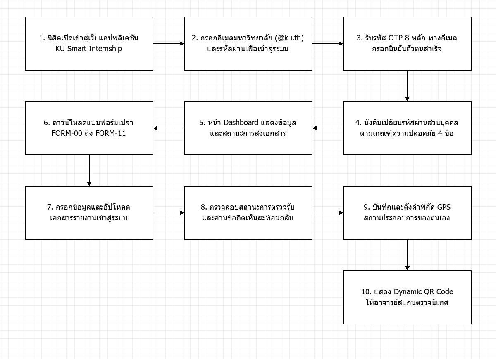
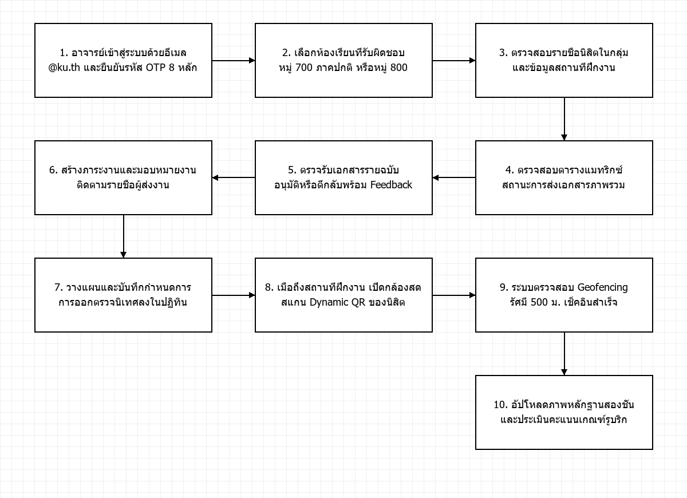
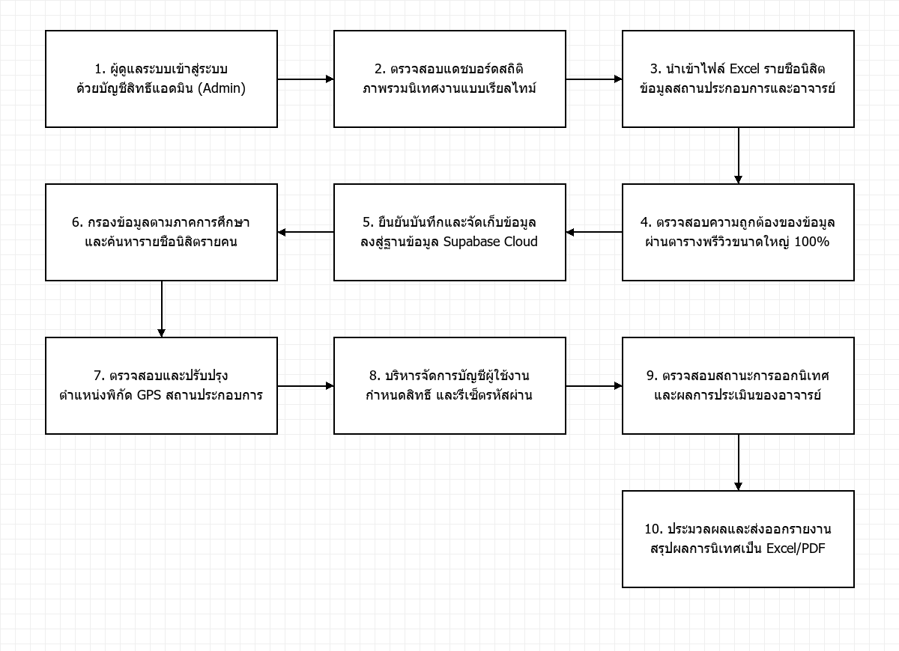

# แบบเสนอโครงงานวิทยาการคอมพิวเตอร์ (Project Proposal)
ภาควิชาวิทยาการคอมพิวเตอร์ คณะวิทยาศาสตร์ มหาวิทยาลัยเกษตรศาสตร์  
รหัสวิชา 01418499 โครงงานวิทยาการคอมพิวเตอร์

**ชื่อโครงงาน (ภาษาไทย):** โครงการพัฒนาระบบจัดการการตรวจนิเทศงานสหกิจศึกษา คณะวิทยาศาสตร์ มหาวิทยาลัยเกษตรศาสตร์  
**ชื่อโครงงาน (ภาษาอังกฤษ):** KU Science Smart Internship Supervision Platform  
**ผู้จัดทำ:** นาย วงศพัทธ์ อุเทน รหัสนิสิต 6510402280 อีเมล wongsapat.u@ku.th  
**อาจารย์ที่ปรึกษา:** อาจารย์ปรวี วงศ์สวัสดิ์สุริยะ  
**ภาคการศึกษา:** ภาคปลาย ปีการศึกษา 2568  

---

## 1. ความสำคัญและที่มาของปัญหา
การฝึกปฏิบัติงานสหกิจศึกษาถือเป็นหลักสูตรสำคัญของภาควิชาวิทยาการคอมพิวเตอร์ คณะวิทยาศาสตร์ มหาวิทยาลัยเกษตรศาสตร์ เพื่อให้นิสิตได้นำความรู้เชิงทฤษฎีไปประยุกต์ใช้ในการทำงานจริง ณ สถานประกอบการ โดยมีกระบวนการตรวจนิเทศงานของอาจารย์ที่ปรึกษาเป็นหัวใจสำคัญในการติดตาม ให้คำปรึกษา และประเมินผลการเรียนรู้ของนิสิต

อย่างไรก็ตาม ในกระบวนการดำเนินงานตรวจนิเทศงานเดิม พบปัญหาและข้อจำกัดสำคัญ 4 ด้าน ดังนี้:
1. **ปัญหาการจัดการเอกสารและความล่าช้า:** การประเมินผลและการส่งเอกสารแบบฟอร์มสหกิจศึกษา (แบบฟอร์ม FORM-00 และ FORM-02 ถึง FORM-11) ยังคงพึ่งพาเอกสารกระดาษหรือไฟล์ดิจิทัลที่ส่งผ่านช่องทางไม่เป็นทางการ ส่งผลให้เอกสารสูญหาย ตรวจสอบความถูกต้องได้ล่าช้า และภาระงานตรวจรับของอาจารย์นิเทศมีความซ้ำซ้อน
2. **ความยากลำบากในการติดตามความคืบหน้ารายบุคคลและการแยกหมู่เรียน:** แต่ละภาคการศึกษามีนิสิตออกฝึกงานจำนวนมากและแบ่งตามหมู่เรียนจริง คือ หมู่ 700 (ภาคปกติ) และหมู่ 800 (ภาคพิเศษ) ซึ่งระบบเดิมไม่มีการรวมศูนย์ข้อมูล ทำให้ผู้บริหารและอาจารย์ไม่สามารถมองเห็นภาพรวมสถิติการออกนิเทศแบบเรียลไทม์ได้
3. **ปัญหาการนัดหมายลงพื้นที่คลาดเคลื่อน:** ขาดระบบปฏิทินกลางที่แสดงผลนัดหมายตรงกันระหว่างอาจารย์ นิสิต และสถานประกอบการ ทำให้ตารางเวลามักซ้ำซ้อนหรือไม่ตรงกัน
4. **การขาดพยานหลักฐานเชิงประจักษ์ในการลงพื้นที่จริง:** ขาดเครื่องมือทางเทคโนโลยีที่ช่วยยืนยันและตรวจสอบได้ว่าอาจารย์ได้ลงพื้นที่ตรวจนิเทศ ณ สถานประกอบการจริงตามเกณฑ์มาตรฐานของมหาวิทยาลัย

ดังนั้น ผู้จัดทำจึงพัฒนาระบบ "KU Science Smart Internship Supervision Platform" เป็นเว็บแอปพลิเคชันแบบตอบสนอง (Responsive Single Page Application) บูรณาการระบบสแกน QR Code แบบเรียลไทม์ร่วมกับ Geolocation API จำกัดรัศมี 500 เมตร คลังภาพถ่ายหลักฐานการนิเทศงาน และระบบความปลอดภัยยืนยันตัวตนด้วยรหัส OTP 8 หลัก ผ่านอีเมลมหาวิทยาลัย เพื่อแก้ปัญหาดังกล่าวอย่างยั่งยืน

---

## 2. วัตถุประสงค์ของโครงงาน
1. เพื่อพัฒนาระบบเว็บแอปพลิเคชันสำหรับบริหารจัดการการตรวจนิเทศงานสหกิจศึกษา คณะวิทยาศาสตร์ มหาวิทยาลัยเกษตรศาสตร์ ที่รองรับการทำงาน 3 บทบาท (ผู้ดูแลระบบ, อาจารย์นิเทศ, นิสิตสหกิจศึกษา)
2. เพื่อพัฒนาระบบตรวจสอบและยืนยันการลงพื้นที่นิเทศงานจริง ณ สถานประกอบการ ด้วยการผสานเทคโนโลยี Dynamic QR Code สแกนเนอร์ และระบบตรวจสอบพิกัด Geolocation API แบบจำกัดรัศมีปลอดภัยไม่เกิน 500 เมตร (500m Geo-Fencing)
3. เพื่อพัฒนาระบบบันทึกและจัดเก็บภาพถ่ายหลักฐานการลงพื้นที่นิเทศงานจริง (Supervision Evidence Gallery) พร้อมกลไกการยืนยันการอัปโหลดสองชั้น
4. เพื่อพัฒนาระบบบริหารจัดการข้อมูลนิสิตผ่านการนำเข้าไฟล์ Excel ขนาดใหญ่แบบพรีวิวเต็มความกว้าง 100% และระบบส่งออกรายงานสรุปผลการนิเทศงานในรูปแบบ Excel และ PDF
5. เพื่อพัฒนาระบบปฏิทินนัดหมายแบบระบุวันตรงกัน และระบบติดตามตรวจสอบสถานะการส่งเอกสารแบบฟอร์มสหกิจศึกษา (แบบฟอร์ม FORM-00 ถึง FORM-11) แบบเรียลไทม์

---

## 3. แผนภาพและขั้นตอนการทำงานของระบบ (System Workflow) และขอบเขตของโครงงาน

### 3.1 work flow แนวคิดในการออกแบบระบบ
การออกแบบระบบยึดหลักการออกแบบที่เน้นผู้ใช้งานเป็นศูนย์กลาง (User-Centric Design) โดยจำแนกตามลำดับขั้นตอนกระบวนการทำงานจริง (Workflow) ของแต่ละกลุ่มผู้ใช้งาน เพื่อให้เห็นความเชื่อมโยงของแต่ละฟังก์ชันและการแลกเปลี่ยนข้อมูลระหว่างผู้ใช้งานกับระบบฐานข้อมูลอย่างมีประสิทธิภาพ ดังนี้:

#### 3.1.1 ขั้นตอนการทำงานของนิสิตสหกิจศึกษา (Student Workflow)
ขั้นตอนการทำงานของนิสิตสหกิจศึกษาเริ่มต้นตั้งแต่การเข้าสู่ระบบเพื่อยืนยันตัวตนสองขั้นตอน การเปลี่ยนรหัสผ่านส่วนบุคคล การดาวน์โหลดแบบฟอร์มเปล่า การจัดเตรียมและอัปโหลดเอกสารรายงาน การติดตามผลการตรวจรับ ตลอดจนการเปิดแสดงบัตรประจำตัวดิจิทัลเพื่อรับการตรวจนิเทศงาน ดังแสดงในภาพที่ 1

  
*ภาพที่ 1 Workflow ขั้นตอนการทำงานของนิสิตสหกิจศึกษา*

จากภาพที่ 1 สามารถอธิบายขั้นตอนการทำงานของนิสิตสหกิจศึกษาได้ดังต่อไปนี้:
1. นิสิตเปิดเข้าสู่เว็บแอปพลิเคชัน KU Science Smart Internship Supervision System ผ่านเว็บเบราว์เซอร์บนเครื่องคอมพิวเตอร์หรือสมาร์ตโฟน
2. นิสิตกรอกบัญชีผู้ใช้งานด้วยอีเมลมหาวิทยาลัยเกษตรศาสตร์ (@ku.th) และรหัสผ่านเพื่อเข้าสู่ระบบ
3. ระบบทำการตรวจสอบความถูกต้องของบัญชี และจัดส่งรหัสผ่านชั่วคราว OTP 8 หลัก ไปยังกล่องข้อความอีเมลมหาวิทยาลัยเพื่อยืนยันตัวตนสองขั้นตอน (Two-Factor Authentication: 2FA)
4. กรณีเป็นการเข้าสู่ระบบครั้งแรก (First-time Login) ระบบจะบังคับให้นิสิตเปลี่ยนรหัสผ่านส่วนบุคคลใหม่ทันทีตามเกณฑ์ความปลอดภัย 4 ข้อ ได้แก่ ความยาวไม่น้อยกว่า 8 ตัวอักษร, ประกอบด้วยตัวพิมพ์ใหญ่, ตัวพิมพ์เล็ก, ตัวเลข และอักขระพิเศษ
5. นิสิตเข้าสู่หน้าหลัก แดชบอร์ดภาพรวมของนิสิต (Student Dashboard) ซึ่งแสดงข้อมูลสำคัญ ได้แก่:
   - 5.1 ข้อมูลส่วนตัว รหัสนิสิต สาขาวิชา อาจารย์นิเทศที่ปรึกษา และสถานที่ฝึกงาน
   - 5.2 แถบแสดงสถานะความก้าวหน้าและการส่งเอกสารสหกิจศึกษาแบบฟอร์ม FORM-00 ถึง FORM-11
   - 5.3 ปฏิทินแสดงกำหนดการและเวลานัดหมายการออกตรวจนิเทศของอาจารย์
6. นิสิตดาวน์โหลดแบบฟอร์มเปล่าสหกิจศึกษา (Blank Forms) ได้แก่ FORM-00 ถึง FORM-11 ในรูปแบบไฟล์ PDF และ Microsoft Word เพื่อนำไปจัดเตรียมข้อมูลและประสานงานกับสถานประกอบการ
7. นิสิตดำเนินการกรอกข้อมูลในเอกสารและอัปโหลดไฟล์รายงานเข้าสู่ระบบ ตลอดจนส่งมอบงานตามภาระงาน (Assignments) ที่อาจารย์นิเทศมอบหมายตามกำหนดเวลา
8. นิสิตติดตามผลการตรวจรับเอกสารแบบเรียลไทม์ โดยสามารถตรวจสอบสถานะการอนุมัติ (อนุมัติผ่าน หรือ ตีกลับแก้ไข) พร้อมอ่านข้อคิดเห็นสะท้อนกลับ (Feedback) จากอาจารย์เพื่อนำไปปรับปรุงแก้ไข
9. นิสิตบันทึกและตั้งค่าตำแหน่งพิกัดทางภูมิศาสตร์ (GPS Coordinates) ของสถานประกอบการที่ตนเองปฏิบัติงานจริง (Student GPS Setting) เพื่อบันทึกพิกัดจริงลงในฐานข้อมูล
10. เมื่ออาจารย์นิเทศเดินทางมาถึงสถานประกอบการ นิสิตเปิดแสดงบัตรประจำตัว Dynamic QR Code ประจำตัวผ่านหน้าจอสมาร์ตโฟน ให้อาจารย์สแกนเพื่อตรวจสอบพิกัด Geofencing และบันทึกผลการนิเทศสำเร็จ

---

#### 3.1.2 ขั้นตอนการทำงานของอาจารย์นิเทศ (Advisor Workflow)
ขั้นตอนการทำงานของอาจารย์นิเทศครอบคลุมตั้งแต่การเลือกห้องเรียนประจำกลุ่ม การตรวจรับเอกสารและให้ข้อเสนอแนะสะท้อนกลับ การมอบหมายภาระงาน การนัดหมายลงปฏิทินกลาง จนถึงการลงพื้นที่ตรวจนิเทศจริงโดยใช้กล้องสดสแกน QR Code ตรวจสอบพิกัด Geofencing และการประเมินคะแนนนิเทศงาน ดังแสดงในภาพที่ 2

  
*ภาพที่ 2 Workflow ขั้นตอนการทำงานของอาจารย์นิเทศ*

จากภาพที่ 2 สามารถอธิบายขั้นตอนการทำงานของอาจารย์นิเทศได้ดังต่อไปนี้:
1. อาจารย์นิเทศเข้าสู่ระบบเว็บแอปพลิเคชันด้วยบัญชีอีเมลมหาวิทยาลัย (@ku.th) และยืนยันความปลอดภัยด้วยรหัส OTP 8 หลัก
2. อาจารย์เลือกห้องเรียนและหมู่เรียนที่รับผิดชอบ ได้แก่ หมู่ 700 (ภาคปกติ) หรือหมู่ 800 (ภาคพิเศษ) เพื่อเข้าถึงข้อมูลนิสิตในกลุ่มที่ตนเองดูแล
3. ตรวจสอบรายชื่อนิสิตในกลุ่ม ข้อมูลสถานประกอบการ เบอร์โทรติดต่อพี่เลี้ยง และรายละเอียดหัวข้อโครงงานสหกิจศึกษา
4. เข้าสู่หน้าตารางแมทริกซ์สถานะเอกสาร (Document Matrix) เพื่อตรวจสอบภาพรวมการส่งเอกสารของนิสิตทุกคนในคราวเดียวแบบเรียลไทม์
5. เปิดตรวจเอกสารรายงานสหกิจศึกษารายฉบับ โดยเลือกผลการประเมิน ได้แก่ อนุมัติรับรองเอกสาร หรือปฏิเสธตีกลับแก้ไขพร้อมระบุข้อคิดเห็นสะท้อนกลับ (Feedback) ให้นิสิตนำไปปรับปรุง
6. จัดการระบบภาระงาน (Assignments) โดยกำหนดหัวข้อ คำชี้แจง วันกำหนดส่งงาน และตรวจสอบรายชื่อนิสิตที่ส่งงานแล้วหรือยังไม่ส่งงาน
7. วางแผนการเดินทางและบันทึกกำหนดการนัดหมายการออกตรวจนิเทศงานลงบนปฏิทินกลางของระบบ เพื่อให้นิสิตและผู้เกี่ยวข้องรับทราบล่วงหน้า
8. เมื่ออาจารย์เดินทางถึงสถานที่ฝึกงาน เปิดเมนูสแกนเนอร์กล้องสด (Live Camera Scanner) บนสมาร์ตโฟน แล้วสแกนบัตร Dynamic QR Code ของนิสิต
9. ระบบทำการถอดรหัสข้อมูล ดึงพิกัด Geolocation ปัจจุบัน และคำนวณระยะห่างด้วย Haversine Formula หากอยู่ภายในรัศมีไม่เกิน 500 เมตร (Geofencing) ระบบจะทำการเช็คอินสำเร็จและแสดงการ์ดสีเขียวรับรองการลงพื้นที่จริง
10. อาจารย์อัปโหลดภาพถ่ายหลักฐานการนิเทศสองชั้น (รูปถ่ายคู่กับนิสิตและพนักงานพี่เลี้ยง) กรอกแบบฟอร์มประเมินคะแนนตามเกณฑ์รูบริก 6 ด้าน และบันทึกผลการนิเทศเสร็จสิ้นสมบูรณ์

---

#### 3.1.3 ขั้นตอนการทำงานของผู้ดูแลระบบ (Admin Workflow)
ขั้นตอนการทำงานของผู้ดูแลระบบครอบคลุมการกำกับดูแลภาพรวม การนำเข้าข้อมูลนิสิตและสถานประกอบการผ่านไฟล์ Excel การตรวจสอบความถูกต้องของข้อมูลผ่านตารางพรีวิว การบริหารจัดการสิทธิ์บัญชีผู้ใช้ และการประมวลผลส่งออกรายงานสรุปผลการนิเทศ ดังแสดงในภาพที่ 3

  
*ภาพที่ 3 Workflow ขั้นตอนการทำงานของผู้ดูแลระบบ*

จากภาพที่ 3 สามารถอธิบายขั้นตอนการทำงานของผู้ดูแลระบบได้ดังต่อไปนี้:
1. ผู้ดูแลระบบ (Administrator) เข้าสู่ระบบแดชบอร์ดส่วนกลางด้วยบัญชีผู้ดูแลระบบ เพื่อบริหารจัดการโครงสร้างและข้อมูลของระบบทั้งหมด
2. ตรวจสอบแดชบอร์ดสถิติภาพรวม (Admin Dashboard) แสดงสรุปจำนวนนิสิตทั้งหมด จำนวนอาจารย์นิเทศ สถานประกอบการ อัตราการส่งเอกสาร และสถิติการนิเทศที่สำเร็จแล้ว
3. นำเข้าข้อมูลเริ่มต้นของภาคการศึกษาผ่านการอัปโหลดไฟล์ Excel (.xlsx) หรือ CSV ซึ่งประกอบด้วยข้อมูลนิสิต อาจารย์นิเทศ และข้อมูลสถานที่ฝึกงาน
4. ระบบแสดงผลข้อมูลผ่านตารางพรีวิวขนาดใหญ่เต็มหน้าจอ (Data Preview Modal 100%) แสดงข้อมูล 7 คอลัมน์หลัก เพื่อให้ตรวจสอบความถูกต้องและความสมบูรณ์ของข้อมูลก่อนบันทึก
5. ผู้ดูแลระบบกดยืนยันการนำเข้า ระบบจะดำเนินการบันทึกและจัดเก็บข้อมูลลงสู่ฐานข้อมูล Supabase Cloud Database แบบ Batch Insertion พร้อมแสดงป๊อปอัปแจ้งผลสัมฤทธิ์
6. ผู้ดูแลระบบสามารถใช้ตัวกรองข้อมูล (Filter) ตามปีการศึกษา ภาคการศึกษา และค้นหารายชื่อนิสิตแบบเรียลไทม์เพื่อตรวจสอบหรือแก้ไขข้อมูลรายบุคคล
7. ตรวจสอบและปรับปรุงตำแหน่งพิกัดทางภูมิศาสตร์ (GPS Latitude/Longitude) ของสถานประกอบการบนแผนที่ เพื่อให้การคำนวณ Geofencing 500 เมตรของอาจารย์นิเทศมีความแม่นยำสูงสุด
8. บริหารจัดการบัญชีผู้ใช้งาน กำหนดสิทธิ์การเข้าถึง (Role-Based Access Control) ตลอดจนการปลดล็อกบัญชีหรือรีเซ็ตรหัสผ่านให้แก่นิสิตและอาจารย์ในกรณีที่เกิดปัญหา
9. ติดตามและตรวจสอบสถานะการออกตรวจนิเทศของอาจารย์แต่ละท่าน ตรวจสอบหลักฐานภาพถ่ายและคะแนนประเมินที่ถูกส่งเข้าสู่ระบบ
10. ประมวลผลและส่งออกรายงานสรุปผลการนิเทศงานของภาควิชาทั้งหมด ในรูปแบบไฟล์ Microsoft Excel (.xlsx) และเอกสารสรุป PDF เพื่อใช้เป็นหลักฐานและนำเสนอต่อคณะวิทยาศาสตร์ต่อไป

---

#### 3.1.4 ขั้นตอนการสแกนและตรวจสอบพิกัด Geofencing 500 เมตร (Geofencing Verification Workflow)
เมื่ออาจารย์กดปุ่มสแกน QR Code ระบบจะทำงานตามลำดับ 6 ขั้นตอน ดังนี้:
- **ขั้นที่ 1:** ระบบเปิดกล้องสดสมาร์ตโฟนผ่าน HTML5 Video Canvas และประมวลผลถอดรหัส QR Code ผ่าน jsQR Library
- **ขั้นที่ 2:** ตรวจจับพิกัดปัจจุบันของอาจารย์ผ่าน W3C Geolocation API
- **ขั้นที่ 3:** ดึงพิกัดสถานที่ตั้งสถานประกอบการของนิสิตจากฐานข้อมูล Supabase
- **ขั้นที่ 4:** ประมวลผลคำนวณระยะห่างด้วยสูตร Haversine Formula แบบเรียลไทม์
- **ขั้นที่ 5:** หากระยะห่าง <= 500 เมตร ระบบอนุมัติเช็คอินและเปลี่ยนสถานะนิสิตเป็น "นิเทศแล้ว" พร้อมเปิดแบบฟอร์มประเมินคะแนน
- **ขั้นที่ 6:** หากระยะห่าง > 500 เมตร ระบบบล็อกการทำรายการทันทีและแสดงการ์ดแจ้งเตือนสีแดงเพื่อป้องกันการทุจริต

---

### 3.2 ขอบเขตของโครงงาน (Project Scope)
#### 3.2.1 ขอบเขตด้านผู้ใช้งาน (User Scope)
1. **ผู้ดูแลระบบ (System Administrator):** นำเข้าข้อมูลไฟล์ Excel ขนาดใหญ่แบบพรีวิว 100%, จัดการบัญชีและสิทธิ์, ติดตามสถิติแยกหมู่ 700/800, แก้ไขพิกัดสถานประกอบการ, และส่งออกรายงานสรุปในรูปแบบ Excel และ PDF
2. **อาจารย์นิเทศ (Faculty Advisor):** เข้าสู่ระบบด้วย OTP 8 หลัก, เลือกดูห้องเรียนตามหมู่ 700/800, ตรวจรับเอกสาร FORM-00 ถึง FORM-11 พร้อมตีกลับแก้ไข, นัดหมายผ่านปฏิทินกลาง, สแกนกล้องสด QR Code ตรวจพิกัด Geofencing 500m, และบันทึกภาพถ่ายหลักฐานสองชั้นพร้อมประเมินรูบริก
3. **นิสิตสหกิจศึกษา (Cooperative Education Student):** เข้าสู่ระบบด้วย OTP 8 หลัก, ดาวน์โหลดแบบฟอร์มเปล่า, อัปโหลดไฟล์รายงาน, ติดตามสถานะเอกสารและข้อคิดเห็นสะท้อนกลับ, ตั้งค่าพิกัด GPS สถานประกอบการ, และเปิดแสดง Dynamic QR Code ให้อาจารย์สแกน

#### 3.2.2 ขอบเขตด้านเทคนิคและสถาปัตยกรรม (Technical Scope)
- **สถาปัตยกรรมระบบ:** Responsive Single Page Application (SPA) รองรับหน้าจอตั้งแต่ 390px (Mobile) จนถึง 1920px (Desktop)
- **ส่วนติดต่อผู้ใช้ (Frontend):** พัฒนาด้วยภาษา HTML5, CSS3, และ JavaScript (Vanilla ES6+) ใช้ฟอนต์มาตรฐาน Sarabun
- **ระบบฐานข้อมูล (Backend & Database):** Supabase Cloud Database (PostgreSQL 15) จำนวน 7 ตารางหลัก พร้อมระบบ Local Storage Cache สำหรับรองรับสภาวะออฟไลน์
- **ระบบพิกัดทางภูมิศาสตร์:** W3C Geolocation API ร่วมกับสูตรคณิตศาสตร์ Haversine Formula กำหนดรัศมีปลอดภัย 500 เมตร
- **ระบบกล้องและสแกนเนอร์:** HTML5 Video Canvas, jsQR Engine, รองรับกล้องสมาร์ตโฟนแบบเรียลไทม์
- **ระบบความปลอดภัย:** ยืนยันตัวตนสองขั้นตอน (Two-Factor Authentication: 2FA) ด้วยรหัส OTP 8 หลัก ผ่านบริการอีเมลมหาวิทยาลัย (@ku.th)

---

## 4. ทฤษฎีและเครื่องมือที่ใช้ในการพัฒนาระบบ
1. **กระบวนการสหกิจศึกษาและแบบฟอร์ม FORM-00 ถึง FORM-11:** ศึกษาข้อกำหนดและเอกสารแบบฟอร์มประเมินตามมาตรฐานของคณะวิทยาศาสตร์ มหาวิทยาลัยเกษตรศาสตร์ เพื่อนำมาแปลงเป็นกระบวนการดิจิทัลอย่างครบวงจร
2. **เทคโนโลยี Single Page Application (SPA):** สถาปัตยกรรมการพัฒนาเว็บแอปพลิเคชันที่โหลดหน้าเอกสารหลักเพียงครั้งเดียว และปรับเปลี่ยนมุมมองเนื้อหาผ่านการเรียกใช้ API แบบ Asynchronous (Fetch API) ส่งผลให้มีความเร็วสูงและตอบสนองได้ทันทีโดยไม่ต้องรีโหลดหน้าจอ
3. **ระบบความปลอดภัย OTP (One-Time Password) ผ่าน SMTP:** การสร้างรหัสผ่านชั่วคราวสุ่ม 8 หลัก และจัดส่งผ่านระบบอีเมลมหาวิทยาลัย (@ku.th) เพื่อยืนยันตัวตนของผู้ใช้งานก่อนเข้าสู่ระบบ
4. **เครื่องมือที่ใช้ในการพัฒนาระบบ มีรายละเอียดดังนี้:**
   - **4.1 HTML (HyperText Markup Language) [9]:** ภาษาคอมพิวเตอร์มาตรฐานที่ใช้สร้างและกำหนดโครงสร้างของหน้าเว็บ โดยใช้การเขียนแท็ก (Tags) เพื่อรับรองและควบคุมการแสดงผลของข้อความ รูปภาพ ฟอร์มกรอกข้อมูล และส่วนประกอบต่าง ๆ บนหน้าจออย่างเป็นระเบียบ
   - **4.2 CSS (Cascading Style Sheets) [10]:** ภาษาที่ใช้สำหรับตกแต่งรูปแบบการแสดงผลของหน้าเว็บที่สร้างด้วย HTML ให้มีความสวยงาม ทันสมัย โดยออกแบบในรูปแบบ Responsive Web Design ในโทนสีเขียวประจำมหาวิทยาลัยเกษตรศาสตร์
   - **4.3 JavaScript (ES6+) [11]:** ภาษาโปรแกรมสำหรับพัฒนาเว็บเพจให้มีการทำงานแบบโต้ตอบ (Interactive) ถูกใช้เป็นกลไกหลักในการควบคุมลอจิกของหน้าบ้านแอปพลิเคชัน (Front-end) เช่น การสลับมุมมอง SPA, การคำนวณระยะห่างพิกัด GPS, การตรวจจับและถอดรหัส QR Code
   - **4.4 Supabase Cloud Database [12]:** แพลตฟอร์มฐานข้อมูลบนคลาวด์แบบโอเพนซอร์สที่ขับเคลื่อนด้วยระบบจัดการฐานข้อมูลเชิงสัมพันธ์ PostgreSQL 15 มีระบบรักษาความปลอดภัยระดับแถว (Row Level Security: RLS) และการเชื่อมต่อผ่าน RESTful API
   - **4.5 ไลบรารี jsQR [13]:** ไลบรารีภาษา JavaScript สำหรับการตรวจจับและถอดรหัส QR Code จากภาพวิดีโอสดได้อย่างแม่นยำและรวดเร็ว โดยประมวลผลบนเครื่องของผู้ใช้งานโดยตรง
   - **4.6 ไลบรารี SheetJS (xlsx) [14]:** ไลบรารีสำหรับประมวลผลไฟล์สเปรดชีต Excel ทั้งการอ่านข้อมูลไฟล์ขนาดใหญ่เพื่อแสดงผลพรีวิวก่อนนำเข้า และการส่งออกข้อมูลสรุปเป็นไฟล์ Excel
   - **4.7 W3C Geolocation API และ Haversine Formula [15]:** การเรียกใช้ API มาตรฐานของเว็บเบราว์เซอร์เพื่อดึงพิกัดละติจูดและลองจิจูดจากอุปกรณ์ ร่วมกับการประยุกต์ใช้สูตรคณิตศาสตร์ Haversine Formula คำนวณระยะทางบนผิวทรงกลมของโลกเพื่อกำหนดรัศมีปลอดภัย Geofencing 500 เมตร

---

## 5. การวิเคราะห์และออกแบบระบบ
### 5.1 การออกแบบฐานข้อมูล (Database Design)
ระบบได้รับการออกแบบฐานข้อมูลเชิงสัมพันธ์ (Relational Database) ประกอบด้วย 7 ตารางหลัก ดังนี้:
1. **users:** จัดเก็บข้อมูลบัญชีผู้ใช้งาน สิทธิ์บทบาท (role: admin, advisor, student) และสถานะการล็อกอินครั้งแรก
2. **advisors:** จัดเก็บข้อมูลอาจารย์นิเทศ อีเมล สังกัดภาควิชา และหมู่เรียนในความดูแล (700/800)
3. **students:** จัดเก็บข้อมูลนิสิต รหัสนิสิต หมู่เรียน สถานที่ฝึกงาน พิกัดละติจูดและลองจิจูด และสถานะการนิเทศ
4. **coop_documents:** จัดเก็บข้อมูลการส่งเอกสารแบบฟอร์ม FORM-00 ถึง FORM-11 สถานะการอนุมัติ และบันทึกข้อเสนอแนะ
5. **appointments:** จัดเก็บข้อมูลตารางนัดหมายตรวจนิเทศ วันที่ เวลา สถานที่ และสถานะการยืนยัน
6. **supervision_photos:** จัดเก็บไฟล์ภาพถ่ายหลักฐานการนิเทศงาน วันที่บันทึก และคำบรรยายภาพ
7. **notifications:** จัดเก็บประวัติการแจ้งเตือนและการส่งรหัส OTP 8 หลัก

### 5.2 สถาปัตยกรรมและการไหลของข้อมูล (Data Flow)
ระบบทำงานในรูปแบบ Client-Server Architecture โดยฝั่ง Client (เว็บเบราว์เซอร์) สื่อสารกับ Supabase Cloud Database ผ่านทาง RESTful API และสื่อสารกับเซิร์ฟเวอร์สำหรับระบบ OTP และการประมวลผลเอกสาร

---

## 6. แผนการดำเนินงานตลอดโครงการ
โครงการมีระยะเวลาดำเนินการรวมทั้งสิ้น 17 สัปดาห์ (มกราคม - พฤษภาคม 2568) แบ่งกิจกรรมดังนี้:

| ขั้นตอนและกิจกรรมการดำเนินงาน | ระยะเวลา | ผลผลิตที่ได้ (Deliverables) |
| :--- | :---: | :--- |
| 1. ศึกษาข้อมูลและรวบรวมความต้องการ (Requirement Gathering) | ม.ค. 2568 | เอกสารความต้องการ และข้อกำหนด TOR |
| 2. ออกแบบระบบและฐานข้อมูล (Architecture, DFD, ERD) | ก.พ. 2568 | แผนภาพ DFD, ERD 7 ตาราง, และสถาปัตยกรรม SPA |
| 3. ออกแบบส่วนต่อประสานผู้ใช้ UI/UX (Responsive Design) | ก.พ. - มี.ค. 2568 | UI Mockup เดสก์ท็อปและโมบายล์ |
| 4. พัฒนาระบบ (Implementation) | มี.ค. - เม.ย. 2568 | ระบบเว็บแอปพลิเคชัน 3 บทบาทพร้อมกล้องสดและ GPS 500m |
| 5. ทดสอบและประเมินผลระบบ (Testing & Evaluation) | เม.ย. - พ.ค. 2568 | ผลทดสอบ 21 Test Cases และคะแนนประเมิน SUS 89.4 |
| 6. จัดทำเล่มรายงานและเอกสารนำเสนอฉบับสมบูรณ์ | พ.ค. 2568 | เล่มรายงานฉบับสมบูรณ์และคู่มือการใช้งาน |

---

## 7. ประโยชน์ที่คาดว่าจะได้รับ
1. ภาควิชาและคณะวิทยาศาสตร์ มีระบบสารสนเทศส่วนกลางที่มีเอกภาพ ปลอดภัย และโปร่งใสในการบริหารจัดการการตรวจนิเทศงานสหกิจศึกษา
2. มีระบบตรวจสอบและยืนยันการลงพื้นที่จริงด้วย Dynamic QR Code และ Geofencing รัศมี 500 เมตร ป้องกันการลงชื่อเช็คอินนอกสถานที่จริงได้อย่างเด็ดขาด
3. ยกระดับการจัดเก็บพยานหลักฐานเชิงประจักษ์ผ่านคลังภาพถ่ายการนิเทศงานสองชั้น (รูปคู่กับนิสิตและพนักงานพี่เลี้ยง)
4. ผู้ดูแลระบบสามารถบริหารจัดการและนำเข้าข้อมูลนิสิตผ่านไฟล์ Excel ขนาดใหญ่ได้อย่างแม่นยำ พร้อมส่งออกรายงานผลการนิเทศในรูปแบบ Excel และ PDF
5. นิสิตสหกิจศึกษาสามารถติดตามตารางนัดหมายที่ตรงกัน ตรวจสอบสถานะเอกสาร FORM-00 ถึง FORM-11 และรับทราบผลคะแนนประเมินสะท้อนกลับจากอาจารย์ได้แบบเรียลไทม์

---

## 8. เอกสารอ้างอิง
[1] Wysa. สืบค้นเมื่อ 3 ธันวาคม 2568, [Online]. แหล่งที่มา: https://www.wysa.com/  
[2] Hevy. สืบค้นเมื่อ 10 ธันวาคม 2568, [Online]. แหล่งที่มา: https://www.hevyapp.com/  
[3] Habitify. สืบค้นเมื่อ 4 มกราคม 2569, [Online]. แหล่งที่มา: https://habitify.me/  
[4] Daily Horoscope. สืบค้นเมื่อ 4 มกราคม 2569, [Online]. แหล่งที่มา: https://apps.apple.com/th/app/the-dailyhoroscope/id363920434?l=th  
[5] SetProduct. (2023). "Notifications UI Design: Best practices, UX tips and popular use cases". สืบค้นเมื่อ 10 สิงหาคม 2568, [Online]. แหล่งที่มา: https://www.setproduct.com/blog/notifications-ui-design  
[6] Smashing Magazine. (2025). "Designing Better Notifications UX". สืบค้นเมื่อ 10 สิงหาคม 2568, [Online]. แหล่งที่มา: https://www.smashingmagazine.com/2025/07/design-guidelines-better-notifications-ux/  
[7] Ashish Vaswani และคณะ. (2017). "Attention Is All You Need". สืบค้นเมื่อ 19 มิถุนายน 2569, [Online]. แหล่งที่มา: https://arxiv.org/abs/1706.03762  
[8] Patrick Lewis, et al. (2020). "Retrieval-Augmented Generation for Knowledge-Intensive NLP Tasks". สืบค้นเมื่อ 19 มิถุนายน 2569, [Online]. แหล่งที่มา: https://arxiv.org/abs/2005.11401  
[9] HTML (HyperText Markup Language). "โครงสร้างและการใช้งานภาษา HTML เบื้องต้น". สืบค้นเมื่อ 25 พฤศจิกายน 2568, [Online]. แหล่งที่มา: https://enfete.co.th/th/html-language-and-html-structure/  
[10] CSS (Cascading Style Sheets). "การออกแบบและตกแต่งหน้าเว็บเพจด้วย CSS". สืบค้นเมื่อ 25 พฤศจิกายน 2568, [Online]. แหล่งที่มา: https://www.w3schools.com/css/  
[11] JavaScript. "คู่มือการเขียน JavaScript และมาตรฐาน ECMAScript 6+". สืบค้นเมื่อ 28 พฤศจิกายน 2568, [Online]. แหล่งที่มา: https://developer.mozilla.org/en-US/docs/Web/JavaScript  
[12] Supabase Inc. "Supabase Documentation: The Open Source Firebase Alternative". สืบค้นเมื่อ 2 ธันวาคม 2568, [Online]. แหล่งที่มา: https://supabase.com/docs  
[13] jsQR Developers. "jsQR: A pure JavaScript QR code reading library". สืบค้นเมื่อ 5 ธันวาคม 2568, [Online]. แหล่งที่มา: https://github.com/cozmo/jsQR  
[14] SheetJS LLC. "SheetJS Community Edition: Spreadsheet Data Processor". สืบค้นเมื่อ 8 ธันวาคม 2568, [Online]. แหล่งที่มา: https://sheetjs.com  
[15] MDN Web Docs. "Geolocation API: Web APIs & Specifications". สืบค้นเมื่อ 12 ธันวาคม 2568, [Online]. แหล่งที่มา: https://developer.mozilla.org/en-US/docs/Web/API/Geolocation_API  
