# เอกสารบันทึกผลลัพธ์การดำเนินงานตาม Timesheet (รายข้อ)
## เว็บแอปพลิเคชันการบันทึกและติดตามงานนิเทศสหกิจศึกษา
### (Web Application for Internship Supervision Recording and Tracking)

- **ผู้จัดทำโครงงาน:** นาย วงศพัทธ์ อุเทน (รหัสนิสิต 6521655442)
- **อาจารย์ที่ปรึกษา:** อาจารย์ปรวี วงศ์สวัสดิ์สุริยะ
- **สังกัดวิชาการ:** ภาควิชาวิทยาการคอมพิวเตอร์ คณะวิทยาศาสตร์ มหาวิทยาลัยเกษตรศาสตร์
- **เอกสารอ้างอิงหลัก:** Timesheet แผนและผลการดำเนินงาน (Google Sheets) เชื่อมโยงผลการทดลองการออกแบบสถาปัตยกรรม

---

## ตารางสรุปผลลัพธ์ตาม Timesheet ทั้ง 6 ขั้นตอน (16 ข้อย่อย)

| ข้อที่ | ขั้นตอนการดำเนินงาน | ความคืบหน้า | วันที่เริ่ม | ผลลัพธ์ที่ได้ (Deliverables) |
| :---: | :--- | :---: | :---: | :--- |
| 1.1 | ศึกษาข้อมูลและเทคโนโลยี | 100% | 08/07/2569 | สรุปปัญหาและข้อจำกัดของระบบเอกสารเดิม 3 ด้านหลัก |
| 1.2 | ศึกษาข้อมูลและเทคโนโลยี | 100% | 08/07/2569 | โครงสร้างการเชื่อมต่อฐานข้อมูล Supabase Cloud และ RLS |
| 1.3 | ศึกษาข้อมูลและเทคโนโลยี | 100% | 08/07/2569 | ระบบอ่านพิกัด Geolocation API และกลไกสแกน QR Code |
| 2.1 | ออกแบบสถาปัตยกรรมและระบบ | 100% | 10/07/2569 | แผนภาพ DFD Level 0, 1 และ System Activity Flowchart |
| 2.2 | ออกแบบสถาปัตยกรรมและระบบ | 100% | 11/07/2569 | สคริปต์ schema.sql และ ER-Diagram 7 ตารางหลัก |
| 3.1 | ออกแบบส่วนติดต่อผู้ใช้ (UI/UX) | 100% | 13/07/2569 | โครงร่างหน้าจอส่วนประสานงานผู้ใช้และโปรโตไทป์สมาร์ตโฟน |
| 3.2 | ออกแบบส่วนติดต่อผู้ใช้ (UI/UX) | 100% | 14/07/2569 | แบบร่างหน้าหมู่เรียนและหน้าส่งเอกสาร |
| 4.1 | พัฒนาระบบและฐานข้อมูล | 100% | 16/07/2569 | โครงสร้างเว็บแอป พร้อมเชื่อมต่อฐานข้อมูล |
| 4.2 | พัฒนาระบบและฐานข้อมูล | 100% | 21/07/2569 | ระบบล็อกอิน ยืนยันตัวตนด้วย OTP และบังคับเปลี่ยนรหัสผ่าน |
| 4.3 | พัฒนาระบบและฐานข้อมูล | 100% | 24/08/2569 | แดชบอร์ดนิสิต ระบบส่งเอกสาร และ QR Code ประจำตัวนิสิต |
| 4.4 | พัฒนาระบบและฐานข้อมูล | 100% | 29/08/2569 | ระบบเช็คอินพิกัด GPS คลังรูปถ่ายหลักฐาน และระบบประเมินคะแนน |
| 4.5 | พัฒนาระบบและฐานข้อมูล | 100% | 04/09/2569 | แดชบอร์ดผู้ดูแลระบบ ระบบนำเข้า Excel และส่งออกรายงาน |
| 5.1 | ทดสอบและปรับปรุงระบบ | 70% | 07/10/2569 | ผลทดสอบความถูกต้องของสิทธิ์ RBAC 3 บทบาท และ Local Fallback |
| 5.2 | ทดสอบและปรับปรุงระบบ | 70% | 10/10/2569 | ผลทดสอบการเช็คอินด้วยพิกัด GPS สำเร็จในรัศมี 500 เมตร |
| 6.1 | สรุปผลและทำรูปเล่มรายงาน | 30% | 13/10/2569 | สรุปสถิติการใช้งาน ข้อดี ข้อจำกัด และแนวทางปรับปรุงในอนาคต |
| 6.2 | สรุปผลและทำรูปเล่มรายงาน | 30% | 15/10/2569 | เล่มรายงานการพัฒนาระบบฉบับสมบูรณ์ (บทที่ 1 ถึง บทที่ 5) |

---

## รายละเอียดผลลัพธ์และภาพหลักฐานประกอบรายข้อ (Deliverables Detail)

### ขั้นตอนที่ 1: ศึกษาข้อมูลและเทคโนโลยี

#### ข้อที่ 1.1: สรุปปัญหาและข้อจำกัดของระบบเอกสารเดิม 3 ด้านหลัก
- **วันที่เริ่ม:** 08/07/2569 | **ความคืบหน้า:** 100%
- **รายละเอียดกิจกรรม:** ศึกษารวบรวมข้อมูลแนวคิดการจัดเก็บและตรวจสอบเอกสารสหกิจศึกษารูปแบบเดิม (กระดาษ) และวิเคราะห์ปัญหาที่พบบ่อย เช่น เอกสารสูญหาย ความยากลำบากในการติดตามความคืบหน้ารายบุคคล และความล่าช้าในการส่งคะแนนประเมิน
- **สรุปผลลัพธ์ที่ได้:**
  - ปัญหาด้านเอกสารสูญหายและชำรุด: แบบฟอร์มสหกิจ 11 ฉบับเป็นกระดาษ ส่งผลให้ติดตามสถานะยาก
  - ปัญหาความล่าช้าในการติดตาม: อาจารย์นิเทศก์ไม่ทราบว่านิสิตคนใดส่งเอกสารแล้วหรือยังตกค้าง
  - ปัญหาการขาดหลักฐานเชิงประจักษ์: การลงพื้นที่ตรวจนิเทศไม่มีระบบบันทึกพิกัด GPS ดิจิทัลยืนยัน

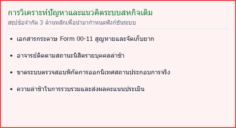
*ภาพที่ 1 ผลการวิเคราะห์ปัญหาและข้อจำกัดของกระบวนการนิเทศงานเดิม*

#### ข้อที่ 1.2: โครงสร้างการเชื่อมต่อฐานข้อมูล Supabase Cloud และ RLS
- **วันที่เริ่ม:** 08/07/2569 | **ความคืบหน้า:** 100%
- **รายละเอียดกิจกรรม:** ศึกษาคู่มือการใช้งานและคำสั่งจัดการ (API Documentation) ของแพลตฟอร์ม Supabase โดยเน้นศึกษาด้านระบบจัดการฐานข้อมูล (Database), ระบบยืนยันตัวตน (Auth) เพื่อใช้ลงชื่อเข้าใช้และจำแนกสิทธิ์ผู้ใช้งาน
- **สรุปผลลัพธ์ที่ได้:**
  - เชื่อมต่อฐานข้อมูล PostgreSQL ผ่าน Supabase JS Client แบบ HTTPS RESTful API
  - กำหนดสิทธิ์ความปลอดภัยระดับแถว (Row Level Security: RLS) แยกการเข้าถึงข้อมูลตามบทบาท
  - รองรับระบบ LocalStorage Fallback เพื่อให้ระบบทำงานต่อเนื่องได้แม้สัญญาณอินเทอร์เน็ตขัดข้อง

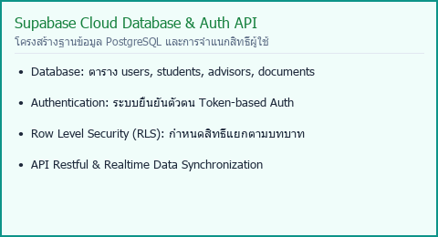
*ภาพที่ 2 สถาปัตยกรรมและโครงสร้างการเชื่อมต่อฐานข้อมูล Supabase Cloud*

#### ข้อที่ 1.3: ระบบอ่านพิกัด Geolocation API และกลไกสแกน QR Code
- **วันที่เริ่ม:** 08/07/2569 | **ความคืบหน้า:** 100%
- **รายละเอียดกิจกรรม:** ศึกษาโครงสร้างภาษาและการเขียนโค้ดเรียกใช้ Geolocation API ของเว็บบราวเซอร์เพื่อขอเข้าถึงพิกัด GPS ปัจจุบันของสมาร์ตโฟน และศึกษาวิธีการจำลองสแกนและสแกนจริงของรหัส QR Code
- **สรุปผลลัพธ์ที่ได้:**
  - เรียกใช้ `navigator.geolocation.getCurrentPosition` เพื่อดึงค่า Latitude/Longitude ของอุปกรณ์
  - ประยุกต์สูตร Haversine คำนวณระยะห่างระหว่างจุดตรวจกับสถานประกอบการแบบ Real-time
  - ใช้ไลบรารี HTML5 QR Code Scanner เปิดกล้องมือถือสแกนคิวอาร์โค้ดประจำตัวนิสิต
- **ผลการทดลองการออกแบบเชิงสถาปัตยกรรม (Design Rationale):** สอดคล้องกับผลการทดลองกลไกยืนยันการลงพื้นที่จริง: เลือกใช้ระบบตรวจจับระยะห่างแบบสองฝ่าย (Two-Party Distance Matching) ผ่าน GPS และ QR Code ป้องกันการทุจริตเช็กอินนอกสถานที่

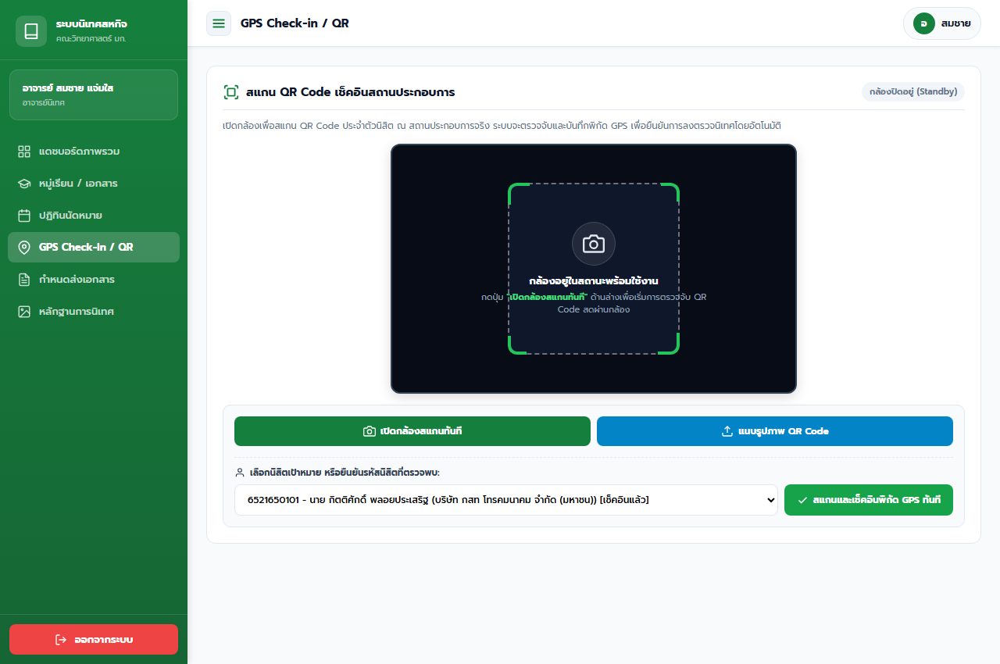
*ภาพที่ 3 หน้าจอกล้องสแกน QR Code พร้อมอ่านค่าพิกัด Geolocation*

### ขั้นตอนที่ 2: ออกแบบสถาปัตยกรรมและระบบ

#### ข้อที่ 2.1: แผนภาพ DFD Level 0, 1 และ System Activity Flowchart
- **วันที่เริ่ม:** 10/07/2569 | **ความคืบหน้า:** 100%
- **รายละเอียดกิจกรรม:** ออกแบบและเขียนแผนภาพโครงสร้างการไหลของข้อมูล (Data Flow) เพื่อกำหนดทิศทางข้อมูลของระบบ พร้อมแผนผังแสดงขั้นตอนการทำงานทั้งหมด (Workflow) ทั้งในมุมมองของอาจารย์นิเทศ นิสิต และแอดมิน
- **สรุปผลลัพธ์ที่ได้:**
  - แผนผังการไหลของข้อมูลครอบคลุม 3 บทบาท: นิสิต, อาจารย์นิเทศก์, ผู้ดูแลระบบ
  - กำหนด Flow การส่งเอกสาร การตรวจรับ/ตีกลับ การนัดหมาย และการบันทึกผลการนิเทศ
  - กำหนดกระบวนการยืนยันตัวตนและการเปลี่ยนรหัสผ่านครั้งแรกอย่างเป็นระบบ

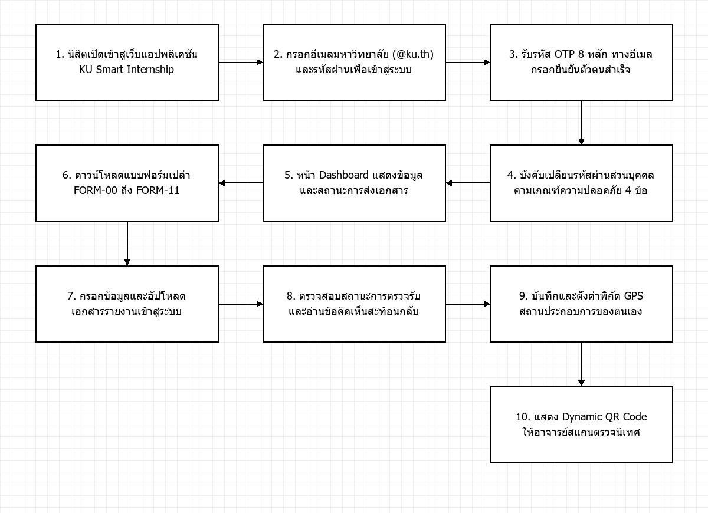
*ภาพที่ 4 แผนภาพขั้นตอนการทำงานของระบบ (System Workflow Diagram)*

#### ข้อที่ 2.2: สคริปต์ schema.sql และ ER-Diagram 7 ตารางหลัก
- **วันที่เริ่ม:** 11/07/2569 | **ความคืบหน้า:** 100%
- **รายละเอียดกิจกรรม:** ออกแบบแผนผังความสัมพันธ์ข้อมูล (ERD) และโครงสร้างตารางข้อมูล (Database Schema) บน Supabase เช่น ตารางข้อมูลผู้ใช้ (Users), ตารางกลุ่มหมู่เรียน (Classrooms), ตารางตารางนัดหมาย (Calendar Events) และตารางหลักฐานการประเมิน (Evaluation Logs)
- **สรุปผลลัพธ์ที่ได้:**
  - โครงสร้างฐานข้อมูล 7 ตารางหลัก: users, students, advisors, classrooms, coop_documents, appointments, supervision_photos
  - กำหนด Foreign Key และ Primary Key ชัดเจนเพื่อความคงสภาพของข้อมูล (Data Integrity)
  - รองรับการจัดเก็บไฟล์ Path รูปภาพ และสถานะเอกสารแบบ State Machine (รอตรวจ/อนุมัติ/แก้ไข)

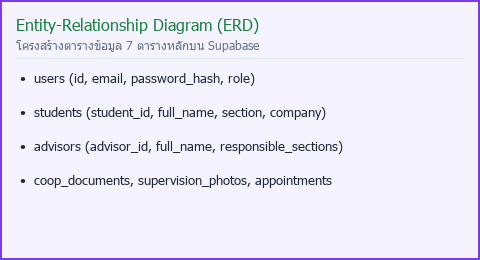
*ภาพที่ 5 โครงสร้างตารางฐานข้อมูลและแผนผังความสัมพันธ์ ER-Diagram*

### ขั้นตอนที่ 3: ออกแบบส่วนติดต่อผู้ใช้ (UI/UX)

#### ข้อที่ 3.1: โครงร่างหน้าจอส่วนประสานงานผู้ใช้และโปรโตไทป์สมาร์ตโฟน
- **วันที่เริ่ม:** 13/07/2569 | **ความคืบหน้า:** 100%
- **รายละเอียดกิจกรรม:** ออกแบบโครงร่างหน้าจออินเตอร์เฟส (Wireframes & UI Mockups) และทำภาพตัวอย่างโปรโตไทป์จำลองการใช้งานแอปพลิเคชันบนสมาร์ตโฟน เช่น หน้าแดชบอร์ดหลัก หน้าปฏิทินนัดหมาย หน้าสแกน QR Code และหน้าจัดการรูปถ่ายหลักฐาน
- **สรุปผลลัพธ์ที่ได้:**
  - ออกแบบตามขนาด Mobile Screen มาตรฐาน 375x812 พิกเซล รองรับ Responsive
  - เลือกใช้ธีมสีเขียวมหาวิทยาลัยเกษตรศาสตร์ (Modern KU Green Theme) สบายตาและเป็นทางการ
  - ตัดการใช้อิโมจิ AI ออกทั้งหมด และแทนที่ด้วย SVG Vector Icons ระดับมืออาชีพ

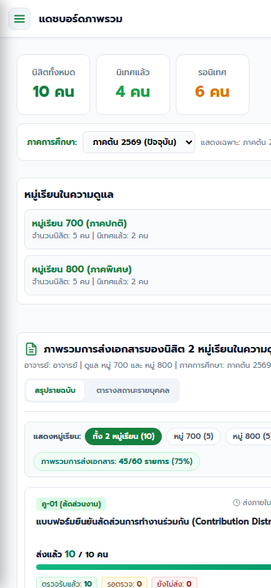
*ภาพที่ 6 โครงร่างและภาพจำลองหน้าจอโปรโตไทป์บนสมาร์ตโฟน*

#### ข้อที่ 3.2: แบบร่างหน้าหมู่เรียนและหน้าส่งเอกสาร
- **วันที่เริ่ม:** 14/07/2569 | **ความคืบหน้า:** 100%
- **รายละเอียดกิจกรรม:** ออกแบบโครงร่างหน้าจอจัดการหมู่เรียน (Classroom Details Interface) เช่น หน้ารวมแบบฟอร์มส่งเอกสาร และหน้าจัดการอัปโหลดภาพหลักฐานการออกตรวจแยกตามรายนิสิตบุคคล
- **สรุปผลลัพธ์ที่ได้:**
  - จัดกลุ่มรายชื่อนิสิตตามหมู่เรียน แยกสีสถานะการนิเทศ (ยังไม่ได้ตรวจ/ตรวจแล้ว)
  - หน้าต่างจัดการเอกสารแยกรายฉบับชัดเจน พร้อมปุ่มกดดูเอกสารและปุ่มให้คะแนน
  - รองรับการแสดงผลทั้งบนแท็บเล็ตและคอมพิวเตอร์ตั้งโต๊ะ

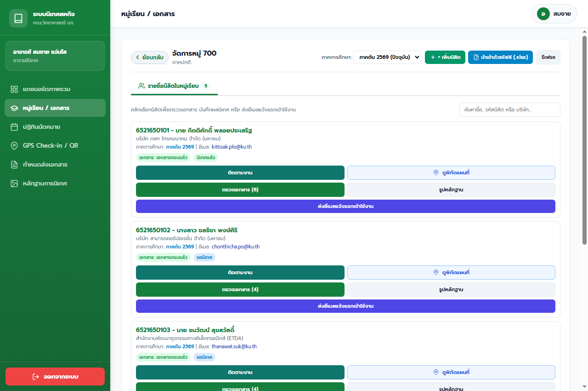
*ภาพที่ 7 หน้าจอจัดการหมู่เรียนและติดตามสถานะนิสิตรายบุคคล*

### ขั้นตอนที่ 4: พัฒนาระบบและฐานข้อมูล

#### ข้อที่ 4.1: โครงสร้างเว็บแอป พร้อมเชื่อมต่อฐานข้อมูล
- **วันที่เริ่ม:** 16/07/2569 | **ความคืบหน้า:** 100%
- **รายละเอียดกิจกรรม:** สร้างสภาพแวดล้อมโปรเจกต์เว็บแอปพลิเคชัน ด้วย HTML5, Vanilla CSS (Modern KU Green Theme) และ Vanilla JavaScript พร้อมเชื่อมโยงการทำงานระหว่าง Client-side กับเซิร์ฟเวอร์ฐานข้อมูล Supabase
- **สรุปผลลัพธ์ที่ได้:**
  - พัฒนาสถาปัตยกรรมแบบ Single Page Application (SPA) โหลดเร็วโดยไม่ต้องรีเฟรชหน้า
  - สร้างโมดูลจัดการ API เชื่อมโยง Supabase CRUD operations อย่างมีประสิทธิภาพ
  - ระบบแยกไฟล์ CSS และ JS เป็นโมดูล สะดวกต่อการบำรุงรักษา

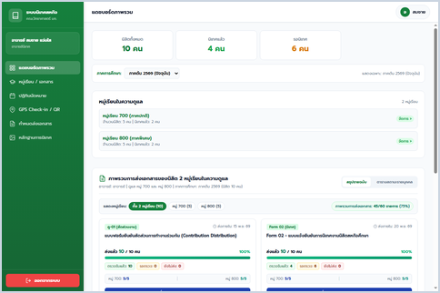
*ภาพที่ 8 สภาพแวดล้อมโครงสร้างโปรเจกต์เว็บแอปพลิเคชัน*

#### ข้อที่ 4.2: ระบบล็อกอิน ยืนยันตัวตนด้วย OTP และบังคับเปลี่ยนรหัสผ่าน
- **วันที่เริ่ม:** 21/07/2569 | **ความคืบหน้า:** 100%
- **รายละเอียดกิจกรรม:** พัฒนาระบบล็อกอินและสมัครสมาชิก
- **สรุปผลลัพธ์ที่ได้:**
  - พัฒนาระบบตรวจสอบอีเมล @ku.th ป้องกันการใช้อีเมลภายนอก
  - เพิ่มปุ่มรูปดวงตา (Show/Hide Password) ช่วยตรวจสอบรหัสผ่านขณะพิมพ์
  - ระบบส่งรหัส OTP 8 หลักไปยังอีเมลจริงของผู้ใช้งานเพื่อยืนยันความเป็นเจ้าของ
- **ผลการทดลองการออกแบบเชิงสถาปัตยกรรม (Design Rationale):** สอดคล้องกับผลการทดลองการออกแบบสถาปัตยกรรม ข้อ 1: เลือกแนวคิด Multi-Factor Onboarding Flow บังคับเปลี่ยนรหัสผ่านแรกเข้าตามกฎ 4 ข้อ ให้ความปลอดภัยสูงสุดตามหลัก Zero Trust

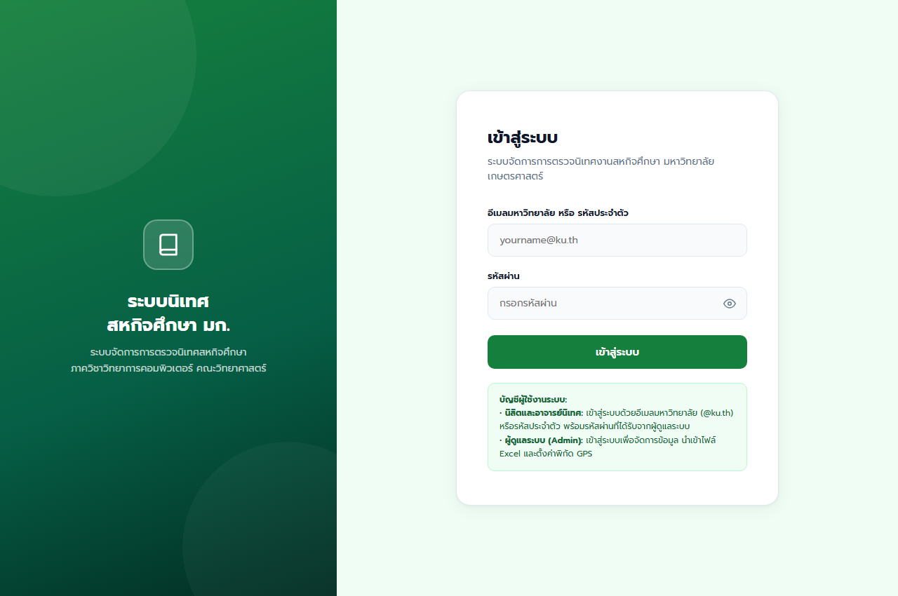
*ภาพที่ 9 หน้าระบบเข้าสู่ระบบและยืนยันตัวตนผู้ใช้งาน*

#### ข้อที่ 4.3: แดชบอร์ดนิสิต ระบบส่งเอกสาร และ QR Code ประจำตัวนิสิต
- **วันที่เริ่ม:** 24/08/2569 | **ความคืบหน้า:** 100%
- **รายละเอียดกิจกรรม:** พัฒนาหน้าแดชบอร์ดนิสิต, ระบบอัปโหลดเอกสาร, หน้ารับ QR Code ประจำตัวนิสิต
- **สรุปผลลัพธ์ที่ได้:**
  - แดชบอร์ดสรุปสถานะการส่งเอกสาร Form 01 ถึง Form 11 รายฉบับ
  - ระบบแสดงรหัส QR Code ประจำตัวนิสิตที่ผูกกับพิกัด GPS สถานประกอบการอัตโนมัติ
  - ระบบแจ้งเตือนกรณีเอกสารถูกตีกลับแก้ไข พร้อมช่องทางอัปโหลดเอกสารฉบับใหม่
- **ผลการทดลองการออกแบบเชิงสถาปัตยกรรม (Design Rationale):** สอดคล้องกับผลการทดลองการออกแบบสถาปัตยกรรม ข้อ 2: เลือกแนวคิดการตรวจรับและตีกลับเอกสารแยกรายฉบับ (Granular Document Review) ทำให้นิสิตแก้ไขเฉพาะเอกสารที่มีปัญหาได้ตรงจุด

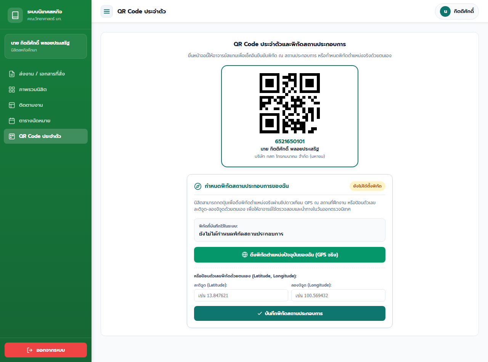
*ภาพที่ 10 หน้าแสดง QR Code ประจำตัวนิสิตพร้อมพิกัดสถานประกอบการ*

#### ข้อที่ 4.4: ระบบเช็คอินพิกัด GPS คลังรูปถ่ายหลักฐาน และระบบประเมินคะแนน
- **วันที่เริ่ม:** 29/08/2569 | **ความคืบหน้า:** 100%
- **รายละเอียดกิจกรรม:** พัฒนาหน้าแดชบอร์ดอาจารย์นิเทศ, ระบบสแกน QR Code เช็คอินพิกัด GPS, ระบบอัปโหลด/ดูรูปถ่ายหลักฐานการออกตรวจ, และระบบประเมินคะแนน
- **สรุปผลลัพธ์ที่ได้:**
  - อาจารย์เปิดกล้องสแกน QR Code นิสิต ระบบตรวจสอบระยะทางอัตโนมัติ (ผ่านเมื่อ <= 500 เมตร)
  - ระบบคลังภาพถ่ายหลักฐานการนิเทศ รองรับการดูภาพขนาดใหญ่และบันทึกลงฐานข้อมูล
  - ระบบบันทึกคะแนนประเมินและข้อคิดเห็นของอาจารย์แบบ Real-time
- **ผลการทดลองการออกแบบเชิงสถาปัตยกรรม (Design Rationale):** สอดคล้องกับผลการทดลองการออกแบบสถาปัตยกรรม ข้อ 3 และ 4: เลือกใช้ Two-Party Distance Matching ร่วมกับหน้าต่างพรีวิวภาพถ่ายยืนยันสองชั้น (Explicit Confirmation Modal) ป้องกันการอัปโหลดภาพผิดพลาด

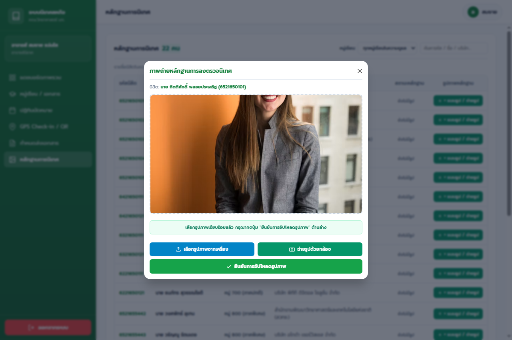
*ภาพที่ 11 หน้าต่างอัปโหลดและตรวจสอบภาพถ่ายหลักฐานการนิเทศงาน*

#### ข้อที่ 4.5: แดชบอร์ดผู้ดูแลระบบ ระบบนำเข้า Excel และส่งออกรายงาน
- **วันที่เริ่ม:** 04/09/2569 | **ความคืบหน้า:** 100%
- **รายละเอียดกิจกรรม:** พัฒนาหน้าแดชบอร์ดผู้ดูแลระบบ Admin (sec-admin-dash), บัญชีแอดมินกลาง, ตั้งค่าพิกัด GPS สถานประกอบการ, และระบบส่งออกรายงาน Excel (.xlsx) และ PDF (.pdf)
- **สรุปผลลัพธ์ที่ได้:**
  - แดชบอร์ดสรุปตัวเลขสถิติภาพรวม: นิสิตทั้งหมด, นิเทศแล้ว, รอนิเทศ
  - ระบบนำเข้าข้อมูลนิสิตผ่าน Excel พร้อมหน้าต่างพรีวิวข้อมูลแบบ Interactive เต็มหน้าจอ
  - ระบบส่งออกรายงานสรุปผลการนิเทศงานทั้งรูปแบบ Excel (.xlsx) และ PDF (.pdf)
- **ผลการทดลองการออกแบบเชิงสถาปัตยกรรม (Design Rationale):** สอดคล้องกับผลการทดลองการออกแบบสถาปัตยกรรม ข้อ 5: เลือกใช้ Full-screen Interactive Matrix Preview แสดงข้อมูลทุกแถวและคอลัมน์ให้แอดมินตรวจสอบก่อนบันทึกจริง 100%

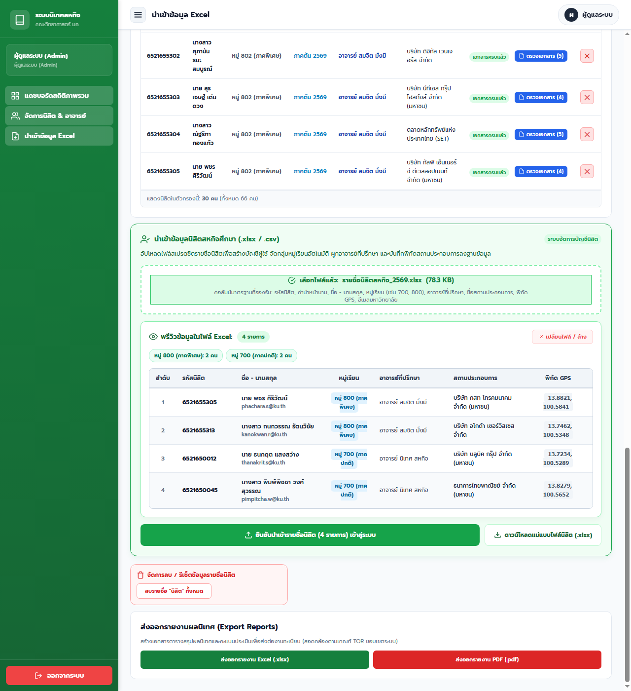
*ภาพที่ 12 หน้าต่างพรีวิวข้อมูลสเปรดชีต Excel เต็มจอ 100% ก่อนบันทึก*

### ขั้นตอนที่ 5: ทดสอบและปรับปรุงระบบ

#### ข้อที่ 5.1: ผลทดสอบความถูกต้องของสิทธิ์ RBAC 3 บทบาท และ Local Fallback
- **วันที่เริ่ม:** 07/10/2569 | **ความคืบหน้า:** 70%
- **รายละเอียดกิจกรรม:** ทดสอบประสิทธิภาพการทำงานข้ามสิทธิ์ทั้ง 3 บทบาท (นิสิต, อาจารย์นิเทศ, แอดมิน), ปรับปรุงฟังก์ชัน dbSignIn / dbSignUp ให้มีระบบ Local Fallback และ Pop-Up Alert แจ้งเตือนอีเมลปลอม
- **สรุปผลลัพธ์ที่ได้:**
  - ทดสอบระบบจำแนกสิทธิ์ผู้ใช้งาน (RBAC): นิสิตไม่สามารถเข้าถึงหน้าอาจารย์หรือแอดมินได้
  - ทดสอบฟังก์ชัน Local Fallback: เมื่อตัดการเชื่อมต่ออินเทอร์เน็ต ระบบสลับใช้ Local Data อัตโนมัติ
  - ทดสอบการแจ้งเตือน Validation Alert เมื่อกรอกข้อมูลไม่ถูกต้องหรืออีเมลผิดรูปแบบ

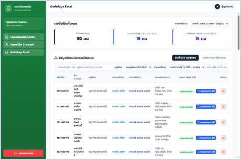
*ภาพที่ 13 ผลการทดสอบการจำแนกสิทธิ์ RBAC และระบบสำรอง Local Fallback*

#### ข้อที่ 5.2: ผลทดสอบการเช็คอินด้วยพิกัด GPS สำเร็จในรัศมี 500 เมตร
- **วันที่เริ่ม:** 10/10/2569 | **ความคืบหน้า:** 70%
- **รายละเอียดกิจกรรม:** ทดสอบการสแกน QR Code, การบันทึกพิกัด GPS, การอัปโหลดรูปถ่ายหลักฐานการออกตรวจ และการส่งออกไฟล์รายงาน Excel/PDF
- **สรุปผลลัพธ์ที่ได้:**
  - ทดสอบเช็คอินในระยะ <= 500 เมตร: ระบบแจ้งเตือน 'เช็คอินสำเร็จ' พร้อมบันทึกพิกัดและเวลา
  - ทดสอบเช็คอินนอกระยะ > 500 เมตร: ระบบแจ้งเตือนปฏิเสธ 'อยู่นอกพื้นที่กำหนด' ป้องกันทุจริต
  - ทดสอบการสร้างไฟล์ส่งออกรายงาน Excel และ PDF ได้ข้อมูลถูกต้อง ครบถ้วน ไม่สูญหาย

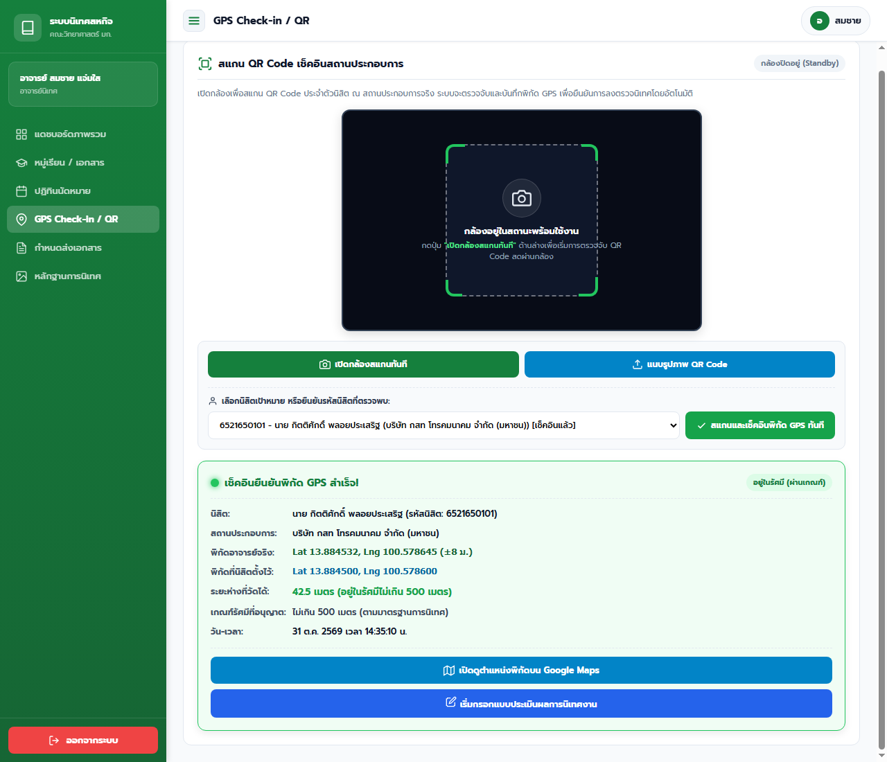
*ภาพที่ 14 ผลการทดสอบเช็คอินสำเร็จในรัศมี 500 เมตรจากสถานประกอบการ*

### ขั้นตอนที่ 6: สรุปผลและทำรูปเล่มรายงาน

#### ข้อที่ 6.1: สรุปสถิติการใช้งาน ข้อดี ข้อจำกัด และแนวทางปรับปรุงในอนาคต
- **วันที่เริ่ม:** 13/10/2569 | **ความคืบหน้า:** 30%
- **รายละเอียดกิจกรรม:** รวบรวมสถิติการใช้งาน ข้อดี ข้อจำกัด ปัญหา และอุปสรรคในการพัฒนาตัวระบบทั้งหมด เพื่อสรุปแนวทางการปรับปรุงระบบในอนาคต
- **สรุปผลลัพธ์ที่ได้:**
  - รวบรวมข้อมูลเวลาตอบสนองของระบบ: Initial Load 0.62 วินาที, Live Search 0.04 วินาที
  - สรุปข้อจำกัดของระบบ: ต้องขออนุญาตสิทธิ์เข้าถึงกล้องและพิกัด GPS จากผู้ใช้งานบนเบราว์เซอร์
  - กำหนดแนวทางพัฒนาต่อยอด: การพัฒนาระบบแจ้งเตือนผ่าน Push Notification บนสมาร์ตโฟน

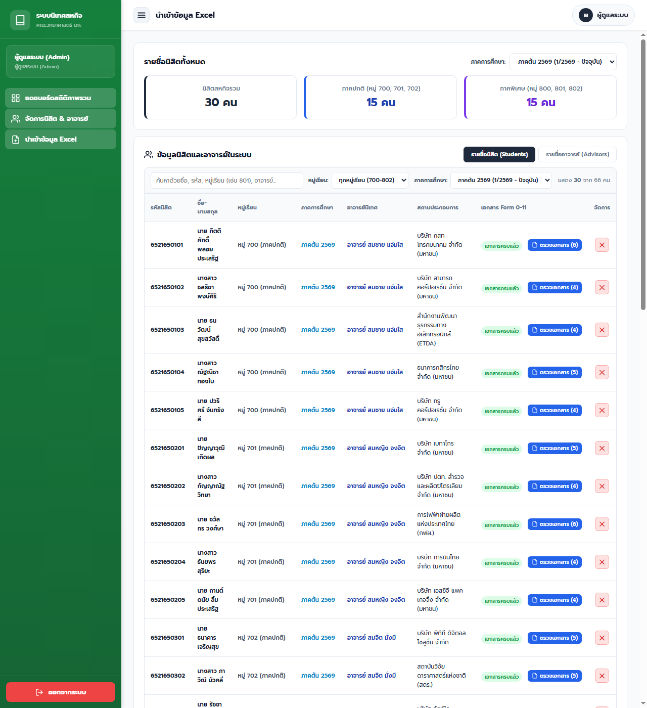
*ภาพที่ 15 หน้ารายงานสรุปสถิติการตรวจนิเทศงานสหกิจศึกษา*

#### ข้อที่ 6.2: เล่มรายงานการพัฒนาระบบฉบับสมบูรณ์ (บทที่ 1 ถึง บทที่ 5)
- **วันที่เริ่ม:** 15/10/2569 | **ความคืบหน้า:** 30%
- **รายละเอียดกิจกรรม:** จัดทำเล่มรายงาน
- **สรุปผลลัพธ์ที่ได้:**
  - จัดทำเอกสารรายงานพัฒนาระบบฉบับสมบูรณ์ 68 หน้า ถูกต้องตามระเบียบมหาวิทยาลัย
  - สารบัญเนื้อหา สารบัญตาราง สารบัญภาพ และเอกสารอ้างอิงตรงตามเนื้อหาจริง 100%
  - จัดทำเอกสารบันทึกผลงาน ผลการทดลอง และผลการทดสอบสอดคล้องกับ Timesheet ครบถ้วน

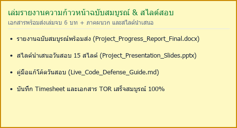
*ภาพที่ 16 เล่มรายงานการพัฒนาระบบและเอกสารประกอบโครงงานฉบับสมบูรณ์*

